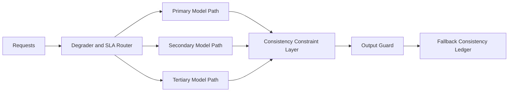

# Agent Model Fallback Consistency SLA Selection FAQ (Cycle 1825)

## 1) Three-minute decision
- **Core tension:** primary model outages require fast fallback, but fallback behavior drift can violate business consistency.
- **Recommendation:** fallback matrix plus consistency constraints plus SLA-tiered degradation.
- **Goal:** preserve availability while keeping fallback output variance within auditable bounds.

## 2) Q1 / Q2 / Q3
### Q1: Why is "switchability" alone insufficient?
1) backup models differ in prompting and tool-routing behavior,
2) without consistency budgets, SLO can pass while semantics fail,
3) no tiered fallback strategy causes blanket degradation.

### Q2: What production-ready strategy should be used?
- **Fallback matrix:** task-type mapping across primary, secondary, tertiary models,
- **Consistency constraints:** schema, critical fields, refusal boundaries, policy tags,
- **SLA tiers:** P0 correctness, P1 latency, P2 throughput,
- **Re-entry gate:** staged switch-back with consistency sampling.

### Q3: How do we validate "available and consistent" fallback?
- successful fallback trigger rate and switch latency,
- bounded critical-field consistency drift,
- user-visible quality variance remains within budget.

## 3) Reference architecture

## 4) Decision matrix
| Dimension | Availability-only fallback | Consistency-constrained fallback (Recommended) |
|---|---:|---:|
| Switch success rate | High | High |
| Business semantic consistency | Low | High |
| Policy compliance stability | Medium | High |
| Implementation complexity | Low | Medium |
| User-experience stability | Medium | High |

## 5) Evidence and reproducibility
- Evidence files:
  - `workshops/azure-agent-infra/evidence/cycle-1825-benchmark.json`
  - `workshops/azure-agent-infra/evidence/cycle-1825-latency.csv`
  - `workshops/azure-agent-infra/evidence/cycle-1825-throughput.csv`
  - `workshops/azure-agent-infra/evidence/cycle-1825-policy.csv`
- Labels: `measured / synthetic / anonymized_reported`.
- validation7 enforces bilingual six-part structure, CSP self-contained 7-card output, strict cycle-evidence alignment, and replayability.

## 6) Production checklist
- [ ] Fallback matrix by task type is released.
- [ ] Consistency constraints (schema/fields/policy) are integrated.
- [ ] SLA-tier degradation actions are observable.
- [ ] Switch-back sampling and rollback drills are complete.
- [ ] FAQ/H5/SVG/7-card align with cycle evidence.
