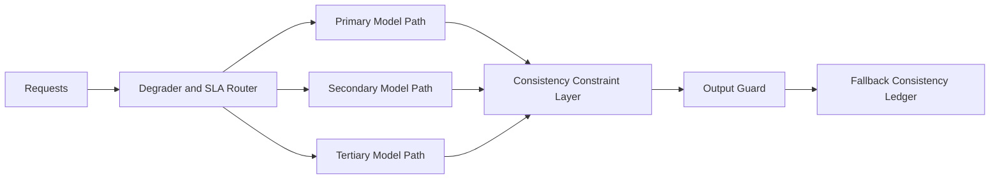

# Agent 模型回退一致性 SLA 选型 FAQ（Cycle 1825）

## 1) 3 分钟结论
- **核心矛盾：** 主模型故障时必须快速切到备模型，但回退后结果风格和策略漂移会破坏业务一致性。
- **推荐：** 多模型回退矩阵 + 一致性约束层 + SLA 分级降级策略。
- **目标：** 在保障可用性的同时，把回退前后输出差异控制在可审计阈值内。

## 2) Q1 / Q2 / Q3
### Q1：为什么只做“可切换”不够？
1) 备模型提示词和工具路由差异会导致行为偏移；
2) 未定义一致性预算时，SLO 达标但业务语义失败；
3) 回退链路缺少分层策略会造成全量降级。

### Q2：生产可落地的回退一致性策略是什么？
- **回退矩阵**：按任务类型映射 primary/secondary/tertiary 模型；
- **一致性约束**：约束输出 schema、关键字段、拒答边界和策略标签；
- **SLA 分层**：P0 保业务正确性，P1 保时延，P2 保吞吐；
- **回切门禁**：主模型恢复后分阶段回切并做一致性抽样。

### Q3：如何验证“回退可用且一致”？
- 回退触发成功率与切换时延达标；
- 回退前后关键字段一致率可控；
- 用户可感知质量波动在预算阈值内。

## 3) 架构图

## 4) 选型矩阵
| 维度 | 仅可用性回退 | 一致性约束回退（推荐） |
|---|---:|---:|
| 切换成功率 | 高 | 高 |
| 业务语义一致性 | 低 | 高 |
| 策略合规稳定性 | 中 | 高 |
| 实施复杂度 | 低 | 中 |
| 用户体验稳定性 | 中 | 高 |

## 5) 证据与复算口径
- 证据文件：
  - `workshops/azure-agent-infra/evidence/cycle-1825-benchmark.json`
  - `workshops/azure-agent-infra/evidence/cycle-1825-latency.csv`
  - `workshops/azure-agent-infra/evidence/cycle-1825-throughput.csv`
  - `workshops/azure-agent-infra/evidence/cycle-1825-policy.csv`
- 标签：`measured / synthetic / anonymized_reported`。
- validation7：双语六段结构、7-card CSP 自包含、轮次与 evidence 一致、可回放链路通过。

## 6) 生产检查清单
- [ ] 回退矩阵按任务分类已发布。
- [ ] 一致性约束规则（schema/字段/策略）已联调。
- [ ] SLA 分层与降级动作可观测。
- [ ] 回切抽样与异常回滚策略已演练。
- [ ] FAQ/H5/SVG/7-card 与 evidence 轮次一致。
