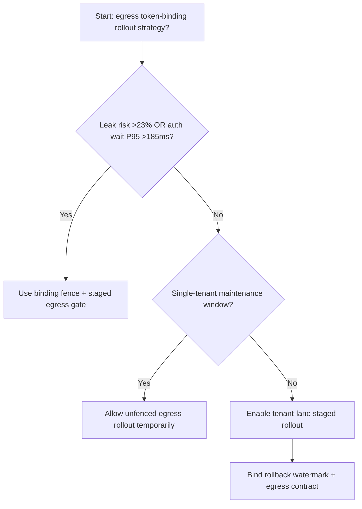
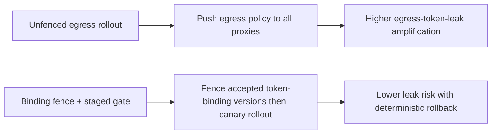
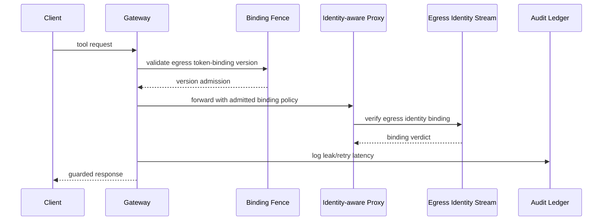

# Agent Network Egress Identity-Aware Proxy Token Binding Selection FAQ (Unfenced Egress Rollout vs Binding Fence + Staged Egress Gate)

## 1) Core conclusions (for decision-makers first)
- **When egress identity token-leak risk exceeds 23% and proxy-auth wait P95 exceeds 185ms, production should default to Binding Fence + Staged Egress Gate**.
- **When unfenced egress-rollout leak rate exceeds 12% and rollback retry P95 exceeds 255ms, Unfenced Egress Rollout enters the 12.7% leak amplification band**.
- **Multi-tenant egress lanes must bind token-binding fences, rollout batches, and rollback watermarks**, or network isolation and audit-chain quality degrade together.

## 2) Q1 / Q2 / Q3 (plain-language definitions first)
- **Unfenced Egress Rollout**: push new egress policy to all proxy nodes directly; fast but risky.
- **Binding Fence + Staged Egress Gate**: constrain accepted token-binding versions first, then shift traffic in batches.

### Q1: Why does token-binding versioning affect agent reliability?
First principles: egress access control depends on identity token binding. Version mismatch makes equivalent requests produce divergent allow/deny outcomes across nodes, amplifying retries and tail latency.

### Q2: When is unfenced rollout acceptable temporarily?
Only in single-tenant low-traffic maintenance windows. Multi-tenant production should default to binding-fenced rollout.

### Q3: What is the minimum safe loop?
Version sampling -> fence validation -> staged rollout -> leak alerts -> automated rollback.

## 3) Mermaid (decision tree / path comparison / sequence)
### 3.1 Selection decision tree

### 3.2 Path comparison

### 3.3 Runtime sequence

## 4) Decision matrix
| Dimension | Unfenced Egress Rollout | Binding Fence + Staged Egress Gate |
|---|---|---|
| Implementation complexity | Low | Medium |
| Token-leak risk | High | Low |
| Multi-tenant controllability | Low | High |
| Rollback determinism | Medium | High |
| Default production fit | Maintenance windows only | Long-term default |

## 5) Evidence contract + recomputable examples (n/denominator/source)
> Percentages in this section are `synthetic_assumed` hypothetical examples for mechanism comparison; production mechanism validation remains `not_measured`.  
> Contract fields: `workshops/azure-agent-infra/evidence/cycle-546-benchmark.json` -> `percentage_contract`.

- Metric A (unfenced egress token-leak rate)  
  - Formula: `n_unfenced_egress_token_leak / n_gateway_requests_observed`  
  - Value: `559/4410 = 12.7%` (`synthetic_assumed`)  
  - Path: `percentage_contract.unfenced_egress_token_leak_rate`
- Metric B (binding-fence leak rate)  
  - Formula: `n_binding_fence_leak / n_gateway_requests_observed`  
  - Value: `221/4410 = 5.0%` (`synthetic_assumed`)  
  - Path: `percentage_contract.binding_fence_leak_rate`
- Metric C (recovery gain, percentage points)  
  - Formula: `(n_recovered_binding_fence - n_recovered_unfenced) / n_gateway_requests_observed`  
  - Value: `(4106-3772)/4410 = 7.6 percentage points` (`synthetic_assumed`)  
  - Path: `percentage_contract.binding_fence_recovery_gain_pts`

## 6) Production checklist
- [ ] Every tenant has egress token-binding version allow-lists and rollout batches
- [ ] Leak rate, retry latency, and rollback success are observable and auditable
- [ ] Change flow supports canary rollout, fast rollback, and tiered promotion
- [ ] All metrics are tagged `synthetic_assumed`; production validation remains `not_measured`
