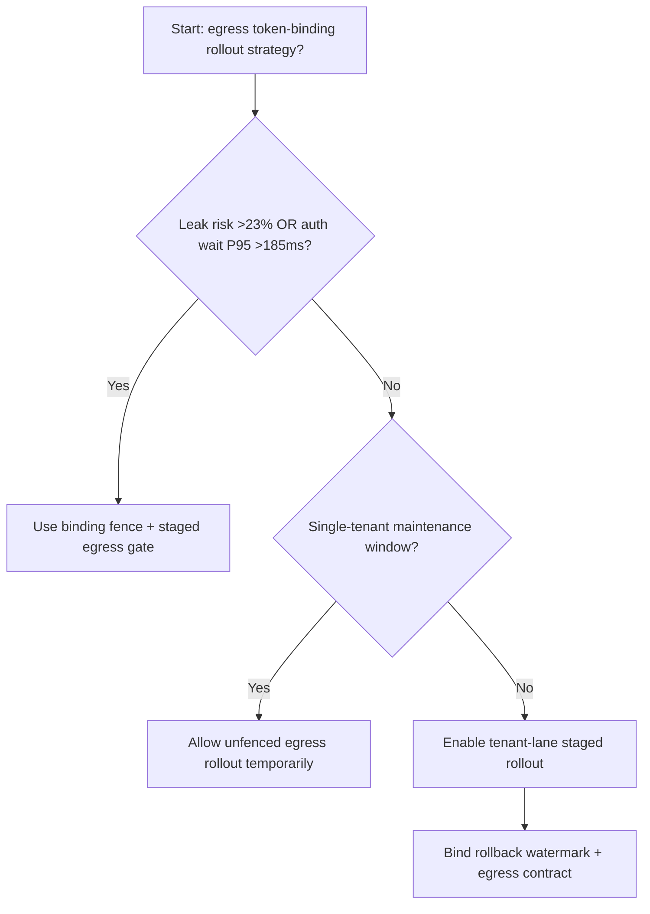
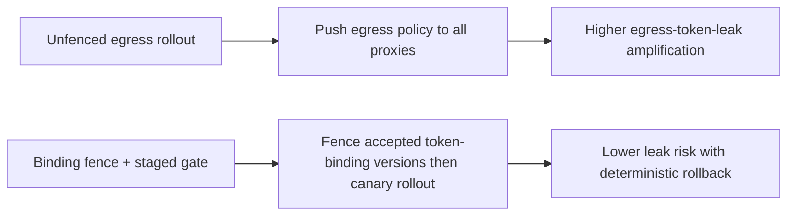
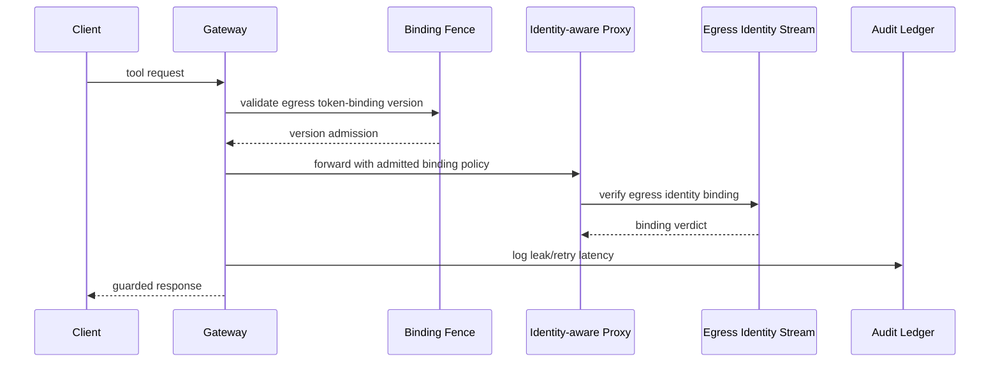

# Agent Network Egress Identity-Aware Proxy Token Binding 选型 FAQ（Unfenced Egress Rollout vs Binding Fence + Staged Egress Gate）

## 1) 核心结论（先给负责人）
- **当 egress 身份令牌泄漏风险 >23% 且代理鉴权等待 P95 >185ms 时，生产默认应启用 Binding Fence + Staged Egress Gate**。
- **当未围栏 egress 发布泄漏率 >12% 且回退重试 P95 >255ms 时，Unfenced Egress Rollout 会进入 12.7% 泄漏放大区间**。
- **多租户出向通道必须绑定“令牌绑定围栏、灰度批次、回滚水位”**，否则网络隔离与审计链会同时退化。

## 2) Q1 / Q2 / Q3（术语先通俗解释）
- **Unfenced Egress Rollout**：直接把新 egress 策略推给所有代理节点，快但风险高。
- **Binding Fence + Staged Egress Gate**：先限制可接受的令牌绑定版本，再按批次切流。

### Q1：为什么令牌绑定版本会影响 Agent 可靠性？
第一性原理：出向访问控制依赖身份令牌绑定。版本失配会导致同请求在不同节点触发不同放行结果，放大重试与尾延迟。

### Q2：什么时候可以短时用 Unfenced 方案？
仅限单租户低流量维护窗；多租户生产应默认启用绑定围栏。

### Q3：最小闭环是什么？
版本采样 -> 围栏校验 -> 分批放量 -> 泄漏告警 -> 自动回滚。

## 3) Mermaid（决策树 / 路径对比 / 时序）
### 3.1 选型决策树

### 3.2 路径对比图

### 3.3 运行时序图

## 4) 选型决策矩阵
| 维度 | Unfenced Egress Rollout | Binding Fence + Staged Egress Gate |
|---|---|---|
| 实现复杂度 | 低 | 中 |
| 令牌泄漏风险 | 高 | 低 |
| 多租户可控性 | 低 | 高 |
| 回滚确定性 | 中 | 高 |
| 生产默认建议 | 仅维护窗 | 长期默认 |

## 5) 数据证据与可复算算例（含 n/分母/来源）
> 本节百分比为 `synthetic_assumed` 假设算例（hypothetical），用于机制比较；生产机制认证保持 `not_measured`。  
> 合同字段见：`workshops/azure-agent-infra/evidence/cycle-546-benchmark.json` 的 `percentage_contract`。

- 指标 A（未围栏 egress 泄漏率）  
  - 定义：`n_unfenced_egress_token_leak / n_gateway_requests_observed`  
  - 值：`559/4410 = 12.7%`（`synthetic_assumed`）  
  - 路径：`percentage_contract.unfenced_egress_token_leak_rate`
- 指标 B（绑定围栏泄漏率）  
  - 定义：`n_binding_fence_leak / n_gateway_requests_observed`  
  - 值：`221/4410 = 5.0%`（`synthetic_assumed`）  
  - 路径：`percentage_contract.binding_fence_leak_rate`
- 指标 C（恢复增益，百分点）  
  - 定义：`(n_recovered_binding_fence - n_recovered_unfenced) / n_gateway_requests_observed`  
  - 值：`(4106-3772)/4410 = 7.6` 个百分点（`synthetic_assumed`）  
  - 路径：`percentage_contract.binding_fence_recovery_gain_pts`

## 6) 生产 Checklist（上线前必须打勾）
- [ ] 每租户都有 egress 令牌绑定版本白名单与切流批次
- [ ] 泄漏率、重试时延、回滚成功率可观测可审计
- [ ] 支持灰度、快速回退与分层放量
- [ ] 指标全部标注 `synthetic_assumed`，生产机制认证保持 `not_measured`
