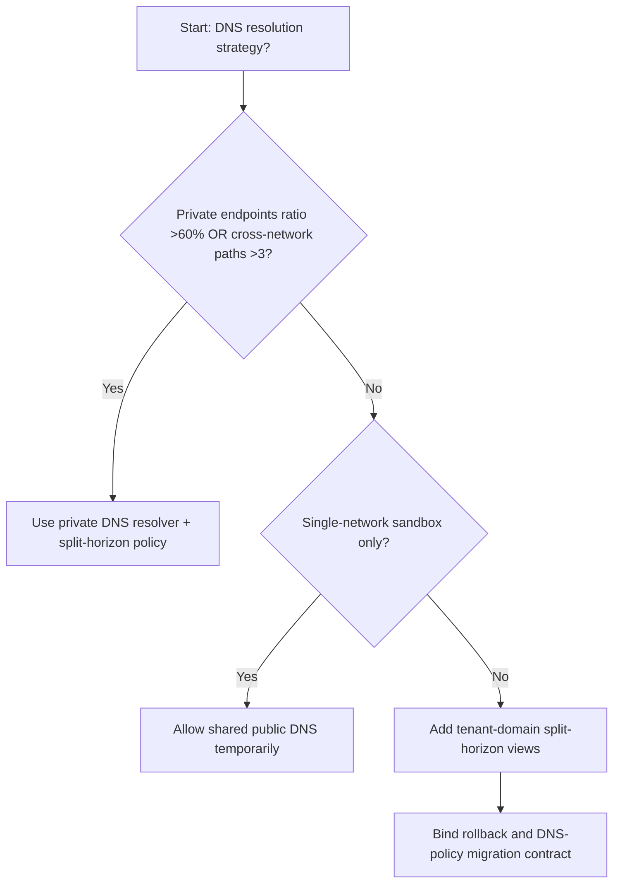
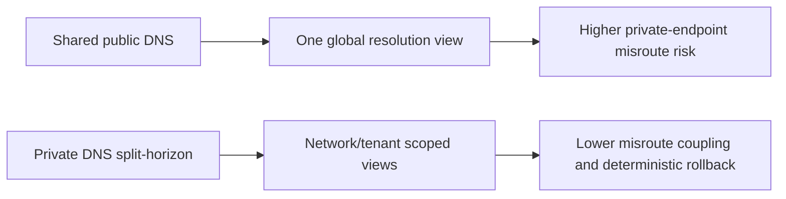
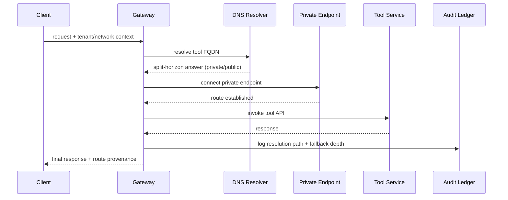

# Agent Network Private Link DNS Split-Horizon Selection FAQ (Shared Public DNS vs Private DNS Resolver + Split-Horizon Policy)

## 1) Core conclusions (for decision-makers first)
- **When cross-network resolution paths exceed 3 and private-endpoint ratio is >60%, production should default to Private DNS Resolver + Split-Horizon Policy**; shared public DNS amplifies misrouting.
- **When resolution-retry share is >8% and service-discovery fallback P95 is >240ms, Shared Public DNS enters the 12.1% misroute band**, requiring private split-horizon policy.
- **When agents must reach multi-region private tool endpoints, split-horizon and tenant-domain isolation are mandatory**, or cross-region resolution drift appears.

## 2) Q1 / Q2 / Q3 (plain-language definitions first)
- **Shared Public DNS**: uses one public DNS path for all targets; simple, but lacks private-network context.
- **Private DNS Resolver + Split-Horizon Policy**: resolves by network/tenant view so identical FQDNs can map differently by context.

### Q1: Why does DNS policy affect agent stability?
First principles: DNS decides where requests go first. Misresolution amplifies retries, cross-region fallback, and auth latency.

### Q2: When is shared public DNS still acceptable temporarily?
Only for single-network PoCs or demos without private endpoints. Move to split-horizon before mixed private-network production.

### Q3: What is the minimum safe loop?
Domain classification -> resolution view policy -> private resolver rollout -> failure replay -> drift calibration.

## 3) Mermaid (decision tree / path comparison / sequence)
### 3.1 Selection decision tree

### 3.2 Path comparison

### 3.3 Runtime sequence

## 4) Decision matrix
| Dimension | Shared Public DNS | Private DNS Resolver + Split-Horizon Policy |
|---|---|---|
| Implementation complexity | Low | Medium |
| Private-route accuracy | Low-Medium | High |
| Cross-region drift risk | High | Low |
| Operational observability | Medium | High |
| Default production fit | Experimental short-term only | Long-term default |

## 5) Evidence contract + recomputable examples (n/denominator/source)
> Percentages in this section are `synthetic_assumed` hypothetical examples for mechanism comparison; production mechanism validation remains `not_measured`.  
> Contract fields: `workshops/azure-agent-infra/evidence/cycle-536-benchmark.json` -> `percentage_contract`.

- Metric A (shared-public misroute rate)  
  - Formula: `n_shared_public_dns_misroute / n_gateway_requests_observed`  
  - Value: `534/4410 = 12.1%` (`synthetic_assumed`)  
  - Path: `percentage_contract.shared_public_dns_misroute_rate`
- Metric B (split-horizon misroute rate)  
  - Formula: `n_split_horizon_dns_misroute / n_gateway_requests_observed`  
  - Value: `216/4410 = 4.9%` (`synthetic_assumed`)  
  - Path: `percentage_contract.split_horizon_dns_misroute_rate`
- Metric C (recovery gain, percentage points)  
  - Formula: `(n_recovered_split_horizon - n_recovered_shared_public_dns) / n_gateway_requests_observed`  
  - Value: `(4058-3728)/4410 = 7.5 percentage points` (`synthetic_assumed`)  
  - Path: `percentage_contract.split_horizon_recovery_gain_pts`

## 6) Production checklist
- [ ] Every tenant/network domain has explicit resolution views and fallback policy
- [ ] Resolution latency, fallback depth, and misroute rate are observable and auditable
- [ ] Change flow supports canary rollout, rollback, and cross-region tiered promotion
- [ ] All metrics are tagged `synthetic_assumed`; production validation remains `not_measured`
