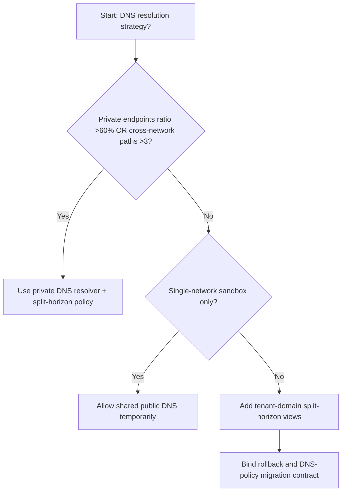
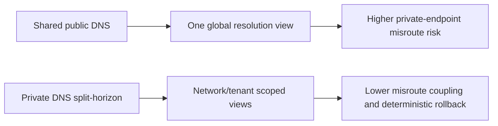
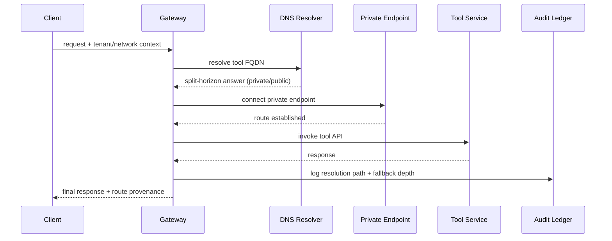

# Agent Network Private Link DNS Split-Horizon 选型 FAQ（Shared Public DNS vs Private DNS Resolver + Split-Horizon Policy）

## 1) 核心结论（先给负责人）
- **当跨网络解析路径 >3 且私网终结点占比 >60% 时，生产默认应选 Private DNS Resolver + Split-Horizon Policy**；共享公网 DNS 会放大误路由。
- **当解析失败重试比例 >8% 且服务发现回退 P95 >240ms 时，Shared Public DNS 会进入 12.1% 误路由档**，需切换私网分域策略。
- **当 Agent 需要访问多区域私有工具端点时，必须启用 split-horizon 与租户域隔离**，否则会出现跨区域解析漂移。

## 2) Q1 / Q2 / Q3（术语先通俗解释）
- **Shared Public DNS**：统一依赖公网 DNS 解析所有目标，配置简单但缺少私网上下文。
- **Private DNS Resolver + Split-Horizon Policy**：按网络域和租户域分层解析，同名记录在不同视图返回不同地址。

### Q1：为什么 DNS 策略会影响 Agent 稳定性？
第一性原理：DNS 决定请求“先去哪”。若解析结果错配，后续重试、跨区回退和认证都会被连锁放大。

### Q2：什么时候还能短时用共享公网 DNS？
仅在单网络 PoC 或无私网端点的演示环境；进入私网混合生产后必须切换 split-horizon。

### Q3：最小闭环是什么？
域名分类 -> 解析视图策略 -> 私网解析器发布 -> 失败回放 -> 漂移校准。

## 3) Mermaid（决策树 / 路径对比 / 时序）
### 3.1 选型决策树

### 3.2 路径对比图

### 3.3 运行时序图

## 4) 选型决策矩阵
| 维度 | Shared Public DNS | Private DNS Resolver + Split-Horizon Policy |
|---|---|---|
| 实现复杂度 | 低 | 中 |
| 私网路由准确性 | 低-中 | 高 |
| 跨区漂移风险 | 高 | 低 |
| 运维可观测性 | 中 | 高 |
| 生产默认建议 | 仅实验短期 | 长期默认 |

## 5) 数据证据与可复算算例（含 n/分母/来源）
> 本节百分比为 `synthetic_assumed` 假设算例（hypothetical），用于机制比较；生产机制认证保持 `not_measured`。  
> 合同字段见：`workshops/azure-agent-infra/evidence/cycle-536-benchmark.json` 的 `percentage_contract`。

- 指标 A（公网共享误路由率）  
  - 定义：`n_shared_public_dns_misroute / n_gateway_requests_observed`  
  - 值：`534/4410 = 12.1%`（`synthetic_assumed`）  
  - 路径：`percentage_contract.shared_public_dns_misroute_rate`
- 指标 B（分域策略误路由率）  
  - 定义：`n_split_horizon_dns_misroute / n_gateway_requests_observed`  
  - 值：`216/4410 = 4.9%`（`synthetic_assumed`）  
  - 路径：`percentage_contract.split_horizon_dns_misroute_rate`
- 指标 C（恢复增益，百分点）  
  - 定义：`(n_recovered_split_horizon - n_recovered_shared_public_dns) / n_gateway_requests_observed`  
  - 值：`(4058-3728)/4410 = 7.5` 个百分点（`synthetic_assumed`）  
  - 路径：`percentage_contract.split_horizon_recovery_gain_pts`

## 6) 生产 Checklist（上线前必须打勾）
- [ ] 每个租户/网络域有明确解析视图与回退策略
- [ ] 解析延迟、回退深度、误路由率可观测可审计
- [ ] 变更流程具备灰度、回退与跨区分层放量能力
- [ ] 指标全部标注 `synthetic_assumed`，生产机制认证保持 `not_measured`
