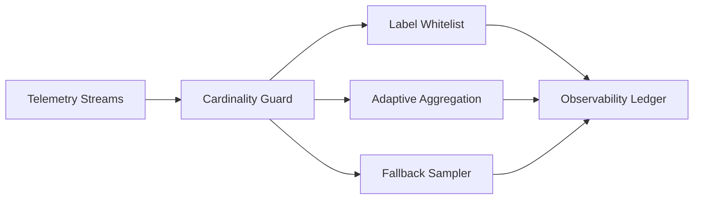

# Agent Observability Cardinality Guard Selection FAQ (Cycle 1803)

## 1) Three-minute decision
- **Observability cost explosions are usually driven not by raw volume, but by unguarded high-cardinality fields.**
- **Recommendation:** label allow-lists + adaptive dimensionality reduction + threshold-triggered fallback sampling.
- **Goal:** preserve debugging value while preventing cardinality-driven storage and query collapse.

## 2) Core questions (Q1/Q2/Q3)
### Q1: Why does high cardinality create cascading impact?
1) label combinations grow exponentially,
2) query latency and cost increase rapidly,
3) alert noise buries critical signals.

### Q2: What is a practical guard strategy?
- layer 1: critical label allow-lists and normalization,
- layer 2: auto-aggregate over-threshold fields,
- layer 3: keep only incident-essential dimensions during anomalies,
- fallback: shift to lightweight sampling on budget alerts.

### Q3: How to validate effectiveness?
- lower cardinality growth slope,
- controlled query P95 and storage spend,
- no regression in incident triage speed.

## 3) Reference architecture

## 4) Decision matrix
| Dimension | No cardinality guard | Cardinality guard (Recommended) |
|---|---:|---:|
| Cost control | Low | High |
| Query stability | Low | High |
| Incident-debug value | Medium | High |
| Config complexity | Low | Medium |
| Operational sustainability | Low | High |

## 5) Evidence and reproducibility
- Evidence files:
  - `workshops/azure-agent-infra/evidence/cycle-1803-benchmark.json`
  - `workshops/azure-agent-infra/evidence/cycle-1803-latency.csv`
  - `workshops/azure-agent-infra/evidence/cycle-1803-throughput.csv`
  - `workshops/azure-agent-infra/evidence/cycle-1803-policy.csv`
- Labels: `measured / synthetic / anonymized_reported`.
- validation7 requires bilingual structure fidelity, CSP self-contained cards, cycle-consistent evidence, and replayability checks.

## 6) Production checklist
- [ ] High-risk labels are covered by allow-list policy.
- [ ] Cardinality thresholds and auto-aggregation rules are load-tested.
- [ ] Budget alerts trigger automatic sampling fallback.
- [ ] Query-latency and cost dashboards support before/after views.
- [ ] FAQ/H5/SVG/7-card align with cycle evidence.
