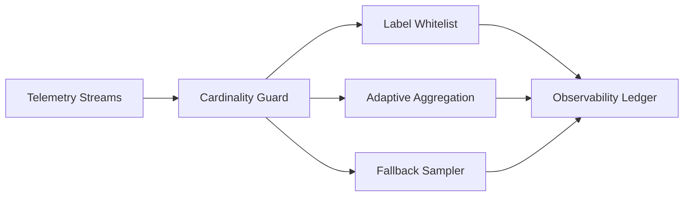

# Agent 可观测性基数护栏选型 FAQ（Cycle 1803）

## 1) 3 分钟结论
- **可观测性成本暴涨通常不是采集量太大，而是高基数字段缺少护栏。**
- **推荐：** 字段白名单 + 动态降维聚合 + 超阈值采样回退。
- **目标：** 保留故障定位能力，同时防止指标/日志基数失控拖垮存储与查询。

## 2) 关键问题（Q1/Q2/Q3）
### Q1：为什么高基数会引发连锁问题？
1) 指标标签组合指数级膨胀；
2) 查询延迟和成本快速上升；
3) 告警噪声增多掩盖关键信号。

### Q2：可落地护栏策略是什么？
- 一级：关键标签白名单与规范化映射；
- 二级：超阈值字段自动降维聚合；
- 三级：异常窗口仅保留问题定位必需维度；
- 回退：触发预算告警后切换轻量采样策略。

### Q3：如何验证策略有效？
- 基数增长斜率显著下降；
- 查询 P95 和存储成本受控；
- 故障定位时效不下降。

## 3) 架构图

## 4) 选型矩阵
| 维度 | 无基数护栏 | 基数护栏（推荐） |
|---|---:|---:|
| 成本可控性 | 低 | 高 |
| 查询稳定性 | 低 | 高 |
| 故障定位能力 | 中 | 高 |
| 配置复杂度 | 低 | 中 |
| 运营可持续性 | 低 | 高 |

## 5) 证据与复算口径
- 证据文件：
  - `workshops/azure-agent-infra/evidence/cycle-1803-benchmark.json`
  - `workshops/azure-agent-infra/evidence/cycle-1803-latency.csv`
  - `workshops/azure-agent-infra/evidence/cycle-1803-throughput.csv`
  - `workshops/azure-agent-infra/evidence/cycle-1803-policy.csv`
- 标签：`measured / synthetic / anonymized_reported`。
- validation7：双语结构、CSP 自包含、证据轮次一致、可回放链路校验通过。

## 6) 生产检查清单
- [ ] 高风险标签已纳入白名单策略。
- [ ] 基数阈值与自动降维规则已压测。
- [ ] 预算告警触发后可自动回退采样。
- [ ] 查询时延与成本看板具备对比视图。
- [ ] FAQ/H5/SVG/7-card 与 evidence 轮次一致。
