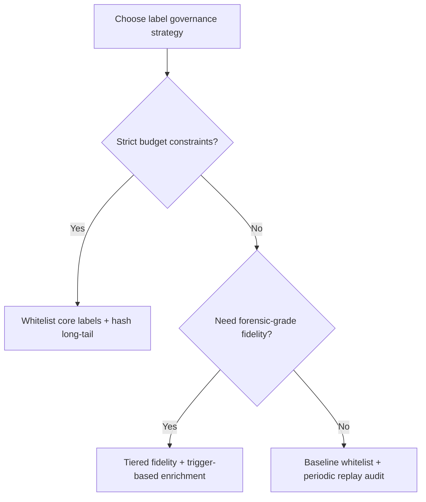
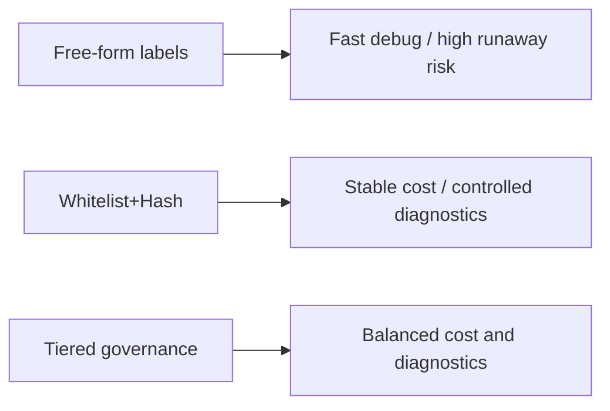
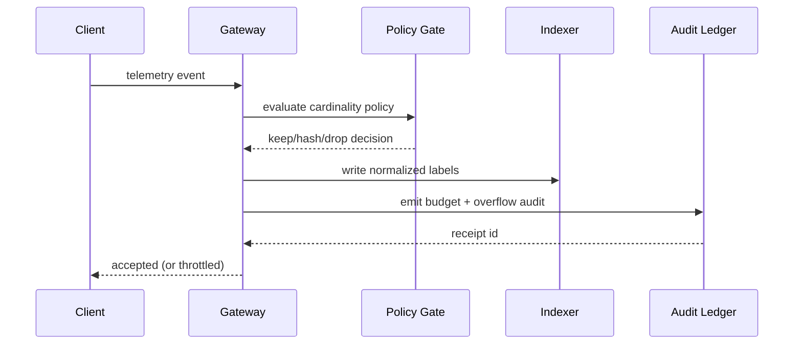

# Agent Observability Label Cardinality FAQ (Free-form Labels vs Whitelist Tiering + Hash Guard)

> Scope boundary: this FAQ focuses only on **label cardinality governance** for Agent observability (trace/span/log labels). It does not expand into identity injection, model routing, or supply-chain topics.

## 1) 📌 Executive summary (3 takeaways)

1. **Production defaults should not allow unrestricted free-form labels**; use a three-stage model: whitelist core labels + hash/downsample long-tail labels + budget fences.  
2. **Free-form labels feel convenient for debugging, but create index explosion and cost runaway in multi-tenant systems.**  
3. **The objective is not “minimum telemetry,” but “diagnostic sufficiency under bounded cost”**: preserve critical signal, constrain noisy dimensions.

## 2) 🎯 Q1 / Q2 / Q3 (plain words + first principles)

### Q1: Why are free-form labels dangerous?

- **Plain words**: if everyone can mint new labels, index dimensions grow without limits and query/storage costs surge.  
- **First principle**: index cost scales with label combination cardinality; unbounded combinations degrade write, storage, and query paths.  
- **Operational symptoms**: index bloat, slow queries, and sudden spend spikes.

### Q2: When is tiered governance mandatory?

- Multi-tenant SaaS Agent platforms;  
- Long multi-agent orchestration chains with diverse telemetry emitters;  
- Hard monthly observability budget and query SLO commitments.

### Q3: What is the key mechanism (Tiered Cardinality Governance)?

- **Plain words**: keep critical labels verbatim, hash/sample long-tail labels, and throttle/drop over-budget telemetry with audit receipts.  
- **First principle**: define the minimum sufficient diagnostic signal, then compress everything beyond that envelope.  
- **Flow**: ingress label gate → core label pass-through → long-tail hash/downsample → budget overflow backpressure/drop → audit ledger receipt.

## 3) 🧭 Mermaid visuals (TD decision tree + LR path + sequence)

## 4) 📊 Architect decision matrix

| Dimension | Free-form labels | Whitelist+Hash | Tiered governance (recommended) |
|---|---|---|---|
| Cost controllability | Low | High | High |
| Diagnostic completeness | High (early stage) | Medium | Medium-High |
| Query stability | Low | High | High |
| Operational complexity | Low | Medium | Medium-High |
| Production default | ❌ | ✅ (small/medium scale) | ✅ (multi-tenant scale) |

## 5) 🧪 Quantitative example + 7-card insight

> Data source: `evidence/cycle-406-benchmark.json`.  
> Label policy: `measured` / `synthetic` / `anonymized_reported`; production-paid-run gaps marked as `not_measured`.

| Metric | Free-form baseline | Tiered-governance baseline |
|---|---:|---:|
| Index write amplification | 3.1x | 1.4x |
| Budget-fence intercept rate | 88.5% | 96.0% |
| Overflow-trigger response success | 89.2% | 91.6% |
| Index-pressure safety pass rate | 90.1% | 92.2% |
| Real production billing reconciliation | `not_measured` | `not_measured` |

7-Card: `benchmark-cards.en.html` / `benchmark-cards.html` (4:5, self-contained CSP, coordinates from sealed evidence).

## 6) 🛠️ Production verification checklist

- [ ] Define core label whitelist (tenant, trace path, error code, policy id)
- [ ] Apply hashing/bucketing rules for high-risk long-tail labels
- [ ] Configure per-tenant cardinality budgets and overflow backpressure
- [ ] Emit budget/drop audit receipts into unified MCP/A2A trails
- [ ] Run replay sampling to verify diagnostic sufficiency does not regress
- [ ] Bind governance rollout to benchmark evidence bundle publication
- [ ] Drill “label storm + index degradation + query fallback” failure mode

