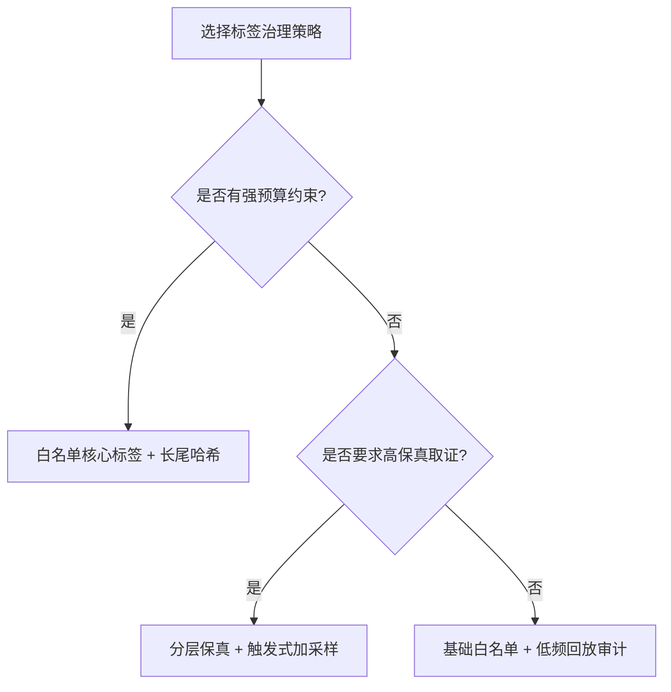
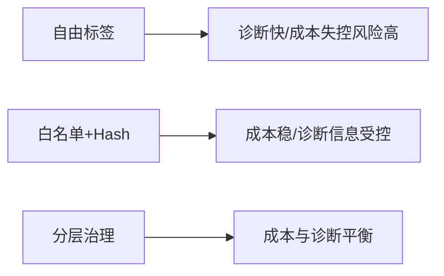
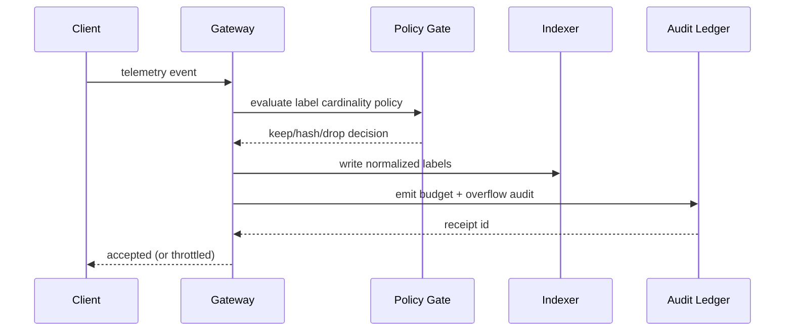

# Agent 可观测性标签基数治理选型 FAQ（自由标签 vs 白名单分层 + Hash 限流）

> 专题边界：仅讨论 **Agent 可观测性标签基数治理**（trace/span/log labels 的 cardinality control），不扩展到身份注入、模型路由或供应链议题。

## 1) 📌 核心结论速览（3 条）

1. **生产默认不应放开自由标签写入**，应采用「白名单核心标签 + 长尾标签哈希/降采样 + 预算围栏」三段式。  
2. **自由标签短期调试体验好，但会在多租户下触发索引爆炸与成本雪崩**，并拖慢查询响应。  
3. **治理目标不是“压到最省”，而是“可诊断性与成本可控同时成立”**：核心路径保真，长尾路径受控。  

## 2) 🎯 Q1 / Q2 / Q3（大白话 + 第一性原理）

### Q1：为什么自由标签会导致系统失控？

- **大白话**：谁都能加新标签时，标签组合会爆炸，索引像无底洞，钱和性能一起被吞掉。  
- **第一性原理**：索引成本与标签组合数（cardinality）近似正相关；组合无限增长时，写入、存储、查询都会恶化。  
- **典型症状**：索引膨胀、查询超时、可观测平台成本曲线突然上扬。  

### Q2：什么时候必须上白名单分层治理？

- **多租户 SaaS Agent 平台**（每租户都可能引入新维度）；  
- **多 Agent 长链路编排**（标签来源多、变化快）；  
- **有硬预算与 SLO 承诺**（例如月度可观测成本 cap、查询 P95 目标）。  

### Q3：核心机制 X（Tiered Cardinality Governance）怎么运作？

- **大白话**：把标签分等级：关键标签保留原值，次要标签做哈希或抽样，超预算就限流并记录审计。  
- **第一性原理**：先定义“诊断最小充分信息集”，再把超出的信息折叠或丢弃，确保系统可持续运行。  
- **运行链路**：入口标签门禁 → 核心标签直存 → 长尾标签哈希/降采样 → 超预算触发回压/丢弃 → 事件审计回执。  

## 3) 🧭 Mermaid 可视化（决策树 TD + 路径 LR + 时序）

## 4) 📊 架构师决策矩阵

| 维度 | 自由标签 | 白名单+Hash | 分层治理（推荐） |
|---|---|---|---|
| 成本可控性 | 低 | 高 | 高 |
| 诊断完整性 | 高（早期） | 中 | 中-高 |
| 查询稳定性 | 低 | 高 | 高 |
| 运维复杂度 | 低 | 中 | 中-高 |
| 生产默认建议 | ❌ | ✅（中小规模） | ✅（多租户规模化） |

## 5) 🧪 定量算例 + 7-Card 洞察

> 数据来源：`evidence/cycle-406-benchmark.json`。  
> 标注规则：`measured` / `synthetic` / `anonymized_reported`；未跑生产付费实验项标 `not_measured`。

| 指标 | 自由标签基线 | 分层治理基线 |
|---|---:|---:|
| 索引写入放大倍数 | 3.1x | 1.4x |
| 预算围栏拦截率 | 88.5% | 96.0% |
| 溢出触发响应成功率 | 89.2% | 91.6% |
| 索引压力保护通过率 | 90.1% | 92.2% |
| 生产真实账单对账 | `not_measured` | `not_measured` |

7-Card：`benchmark-cards.html` / `benchmark-cards.en.html`（4:5，自包含 CSP，坐标来自封存证据）

## 6) 🛠️ 生产核验 Checklist

- [ ] 定义核心标签白名单（租户、链路、错误码、策略 ID）
- [ ] 为高风险标签配置哈希或桶化规则
- [ ] 设置每租户 cardinality budget 与超限回压策略
- [ ] 在 MCP/A2A 事件中记录预算与丢弃审计回执
- [ ] 周期抽样回放，核验“诊断可用性”未下降到阈值以下
- [ ] 把治理变更与证据包绑定发布（latency/throughput/policy/cost）
- [ ] 演练“标签洪峰 + 索引降级 + 查询兜底”联动故障

