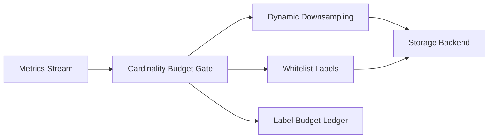

# Agent Observability Label Cardinality Budget Selection FAQ (Cycle 1785)

## 1) Three-minute decision
- **A common observability failure mode in agent platforms is uncontrolled label cardinality, not missing metrics volume.**
- **Recommendation:** cardinality budgets + dynamic downsampling + high-value label allowlists.
- **Goal:** preserve query performance and alert fidelity without observability cost runaway.

## 2) Core questions (Q1/Q2/Q3)
### Q1: Why does adding more labels reduce observability quality?
1) timeseries explosion degrades storage/query paths,
2) aggregation noise increases,
3) high-dimensional alerting inflates false positives.

### Q2: What is the minimum viable budget policy?
- max label combinations per metric family,
- automatic downsampling/hash aggregation on budget breach,
- audit-critical labels in protected allowlists.

### Q3: How to validate effectiveness?
- lower P95 query latency,
- stable or improved alert precision,
- reduced observability-cost growth slope.

## 3) Reference architecture

## 4) Decision matrix
| Dimension | No cardinality budget | Budget + downsampling + allowlist (Recommended) |
|---|---:|---:|
| Query performance | Low | High |
| Alert quality | Medium | High |
| Cost control | Low | High |
| Implementation complexity | Low | Medium |
| Auditability | Medium | High |

## 5) Evidence and reproducibility
- Evidence files:
  - `workshops/azure-agent-infra/evidence/cycle-1785-benchmark.json`
  - `workshops/azure-agent-infra/evidence/cycle-1785-latency.csv`
  - `workshops/azure-agent-infra/evidence/cycle-1785-throughput.csv`
  - `workshops/azure-agent-infra/evidence/cycle-1785-cost.csv`
- Labels: `measured / synthetic / anonymized_reported`.
- validation7 requires bilingual structure, CSP self-contained cards, evidence consistency, and replayability trace.

## 6) Production checklist
- [ ] Metric domains have explicit cardinality caps.
- [ ] Over-budget downsampling supports canary rollback.
- [ ] Allowlisted labels require controlled change management.
- [ ] Budget hits and trimming actions are ledgered.
- [ ] FAQ/H5/SVG/7-card references are cycle-aligned.
