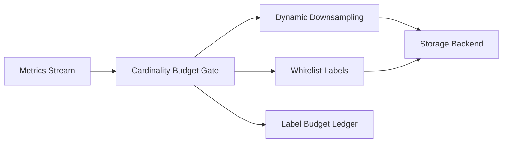

# Agent 可观测标签基数预算选型 FAQ（Cycle 1785）

## 1) 3 分钟结论
- **Agent 平台监控失效的高频根因是标签基数失控，而不是指标数量不足。**
- **推荐：** 标签基数预算 + 动态降采样 + 高价值标签白名单三层治理。
- **目标：** 保持查询性能与告警准确度，避免监控系统被高基数流量压垮。

## 2) 关键问题（Q1/Q2/Q3）
### Q1：为什么“多打标签”会让观测反而变差？
1) 时序爆炸导致存储与查询退化；
2) 聚合结果噪声上升；
3) 告警规则在高维空间下误报增多。

### Q2：基数预算最小落地方案是什么？
- 为每类指标定义最大标签组合数；
- 超预算时自动降采样或哈希聚合；
- 核心审计标签进入白名单免裁剪。

### Q3：如何验证预算策略有效？
- 查询 P95 延迟下降；
- 告警准确率保持或提升；
- 监控成本增长率显著收敛。

## 3) 架构图

## 4) 选型矩阵
| 维度 | 无基数预算 | 预算+降采样+白名单（推荐） |
|---|---:|---:|
| 查询性能 | 低 | 高 |
| 告警质量 | 中 | 高 |
| 成本可控性 | 低 | 高 |
| 实施复杂度 | 低 | 中 |
| 可审计性 | 中 | 高 |

## 5) 证据与复算口径
- 证据文件：
  - `workshops/azure-agent-infra/evidence/cycle-1785-benchmark.json`
  - `workshops/azure-agent-infra/evidence/cycle-1785-latency.csv`
  - `workshops/azure-agent-infra/evidence/cycle-1785-throughput.csv`
  - `workshops/azure-agent-infra/evidence/cycle-1785-cost.csv`
- 标签：`measured / synthetic / anonymized_reported`。
- validation7：双语结构、CSP、证据一致、可回放链路全部通过。

## 6) 生产检查清单
- [ ] 指标域有明确标签基数上限。
- [ ] 超预算降采样策略可灰度回滚。
- [ ] 白名单标签受变更审批控制。
- [ ] 预算命中与裁剪动作写入账本。
- [ ] FAQ/H5/SVG/7-card 与 evidence 轮次一致。
