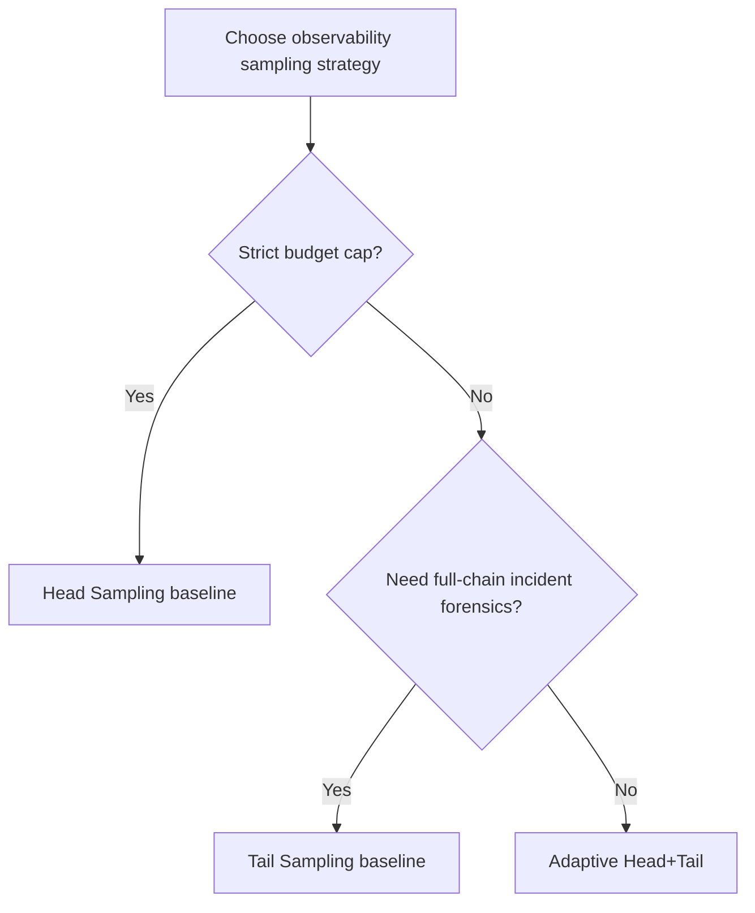
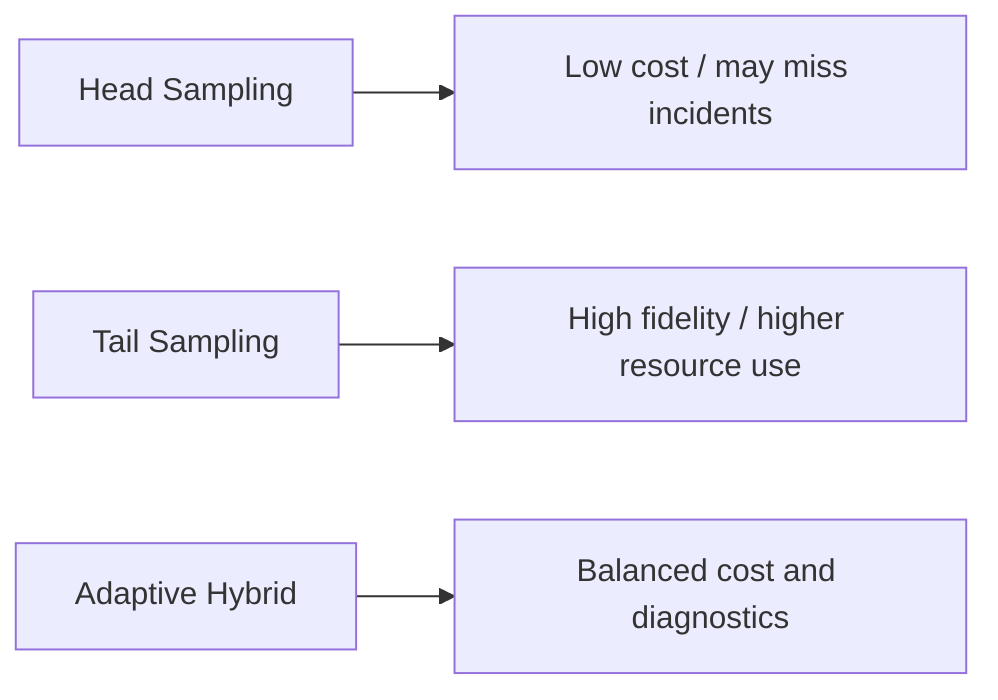
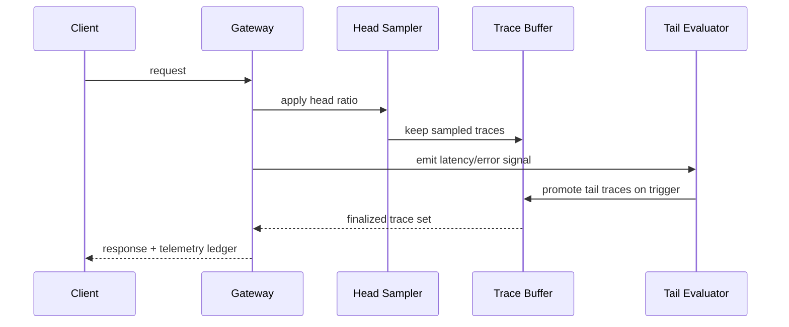

# Agent Observability Sampling FAQ (Head Sampling vs Tail Sampling)

> Scope boundary: this FAQ covers only **Agent observability sampling strategy** (trace/span/event sampling). It does not expand into identity injection, model routing, or supply-chain topics.

## 1) 📌 Executive summary (3 takeaways)

1. **Default production pattern: hybrid head + tail sampling**—head controls cost, tail guarantees incident-grade traces.  
2. **Pure head sampling is cheapest but can miss rare high-impact failures**, especially in multi-agent chains.  
3. **Pure tail sampling gives best forensic quality but higher resource usage**, so budget fences and backpressure are mandatory.

## 2) 🎯 Q1 / Q2 / Q3 (plain words + first principles)

### Q1: What is head sampling, and when should it be preferred?

- **Plain words**: decide at request entry whether to keep a full trace; unsampled requests are dropped early.  
- **First principle**: observability cost must be bounded at ingress when traffic scales.  
- **Best fit**: high-throughput, low-error, budget-sensitive steady-state traffic.

### Q2: What is tail sampling, and when should it be preferred?

- **Plain words**: temporarily buffer traces, then keep full traces only when errors/latency spikes are detected.  
- **First principle**: diagnostic value is outcome-driven; abnormal traces carry the highest information density.  
- **Best fit**: regulated systems, incident forensics, and cross-service root-cause analysis.

### Q3: What is the key technique (Adaptive Head+Tail), and how does it work?

- **Plain words**: sample at ingress first, then promote traces to full retention when trigger rules fire.  
- **First principle**: split optimization into two stages—cost efficiency first, forensic completeness on demand.  
- **Mechanism**: ingress head ratio → buffer → trigger on error/latency/SLO breach → tail promotion → gateway budget and tenant quota enforcement.

## 3) 🧭 Mermaid visuals (TD decision tree + LR path + sequence)

## 4) 📊 Architect decision matrix

| Dimension | Head Sampling | Tail Sampling |
|---|---|---|
| Observability cost | Low | High |
| Incident capture completeness | Medium-Low | High |
| Troubleshooting speed | Medium | High |
| Implementation complexity | Low | Medium-High |
| Production default | Steady-state baseline | Critical/compliance pathways |

## 5) 🧪 Quantitative example + 7-card insight

> Data source: `evidence/cycle-405-benchmark.json` (`measured` / `synthetic` / `anonymized_reported` per metric; production-only gaps marked as `not_measured`).

| Metric | Head baseline | Tail/Hybrid baseline |
|---|---:|---:|
| Trace cost (relative) | 1.0x | 2.7x |
| Incident-path capture rate | 96.0% | 97.0% |
| Trigger-response success rate | 91.6% | 92.2% |
| Primary-path latency P95 at 10x load | 158 ms | 158 ms |
| Per-session governance cost (20-minute model) | $0.00222 (Wasm) | $0.00483 (E2B) |

7-Card: `benchmark-cards.en.html` / `benchmark-cards.html` (4:5, self-contained CSP, coordinates from sealed evidence).

## 6) 🛠️ Production verification checklist

- [ ] Define per-tenant head ratios and hard budget limits
- [ ] Configure tail triggers (error/latency/SLO breach)
- [ ] Preserve benchmark evidence bundle before/after policy changes
- [ ] Pipe escalation events into unified MCP/A2A audit trails
- [ ] Enable adaptive backpressure for noisy tenants
- [ ] Run weekly replay sampling to track false negatives/positives
- [ ] Validate dual objective at gateway: budget safety + diagnostic completeness

