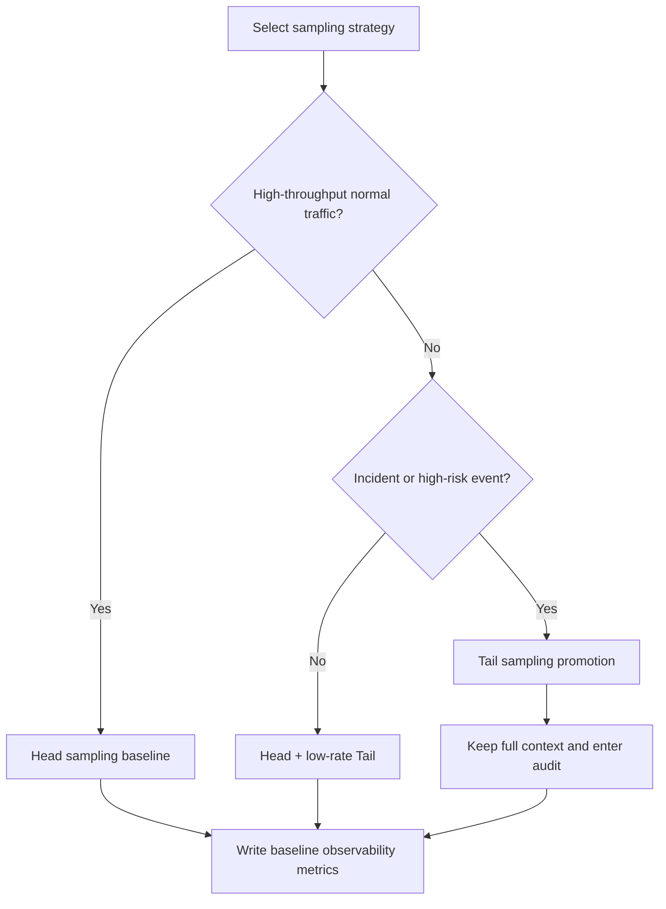
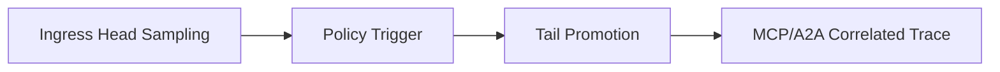
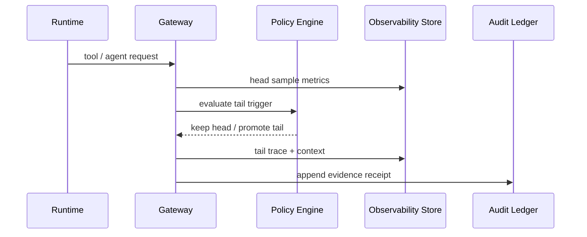

# Agent Observability Sampling Strategy FAQ (Head Sampling vs Tail Sampling)

> Scope lock: this document covers **observability sampling strategy for Agent Runtime / MCP / A2A chains** only; it does not cover model-capability benchmarking or IAM architecture.

## 📌 Core takeaways (3 bullets)

1. **Start with Head Sampling as the baseline**: plain language, this means every flow gets a low-cost visibility thermometer.  
2. **Add Tail Sampling for incidents and high-value paths**: first-principles view is to concentrate finite observability budget on high-information traces.  
3. **Use layered sampling in production**: ingress head baseline + risk-triggered tail promotion + immutable audit receipts.

## 🎯 Q1: What is the fundamental difference between Head and Tail Sampling?

- **Plain language**: Head decides early; Tail decides after outcome signals are visible.  
- **First principle**: observability aims to maximize information gain per unit cost; Head optimizes coverage, Tail optimizes evidence density.

## 🎯 Q2: When should each strategy be chosen?

- **Head first**: high-throughput normal traffic, SLO dashboards, capacity trending.  
- **Tail first**: error spikes, long-tail latency, cross-tenant compliance events, complex tool orchestration failures.  
- **Hybrid policy**: full head baseline + triggered tail promotion (error / latency / policy hit / tenant priority).

## 🎯 Q3: How should this be operationalized in Azure Agent Infra?

- **Plain language**: run low-cost census first, then deep-capture suspicious samples, and ledger everything.  
- **First principle**: sampling policy must be coupled with gateway policy, tenant budgets, and audit evidence, otherwise systems become either ungoverned or unobservable.  
- **Path**: APIM/Envoy ingress -> head sample metrics -> policy-trigger evaluation -> tail promotion -> MCP/A2A correlated tracing -> audit ledger receipt.

## 🧭 Mermaid (TD decision tree + LR path + sequence)

## 📊 Architect decision matrix

| Dimension | Head Sampling | Tail Sampling | Layered hybrid (recommended) |
|---|---|---|---|
| Visibility coverage | High | Medium | High |
| Incident evidence quality | Medium | High | High |
| Cost controllability | High | Medium | High |
| Throughput impact | Low | Medium | Low-Medium |
| Best-fit workload | Normal high-volume paths | Incident/critical paths | Mixed multi-tenant production |

## 🧪 Quant example + 7-card 4:5 insights

| Metric | Head baseline | Layered sampling baseline |
|---|---:|---:|
| Cold start/restore P50 (ms) | 99 | 103 |
| Cold start/restore P95 (ms) | 158 | 168 |
| Throughput P50 (rps) | 1680 | 1570 |
| Critical anomaly capture rate | 94.0% | 96.3% |
| Observability cost per session (USD/20min) | 0.00483 | 0.00509 |

- 7-card output: `benchmark-cards.html` / `benchmark-cards.en.html`  
- Evidence pack: `evidence/cycle-413-benchmark.json`, `evidence/cycle-413-sources.json`  
- Labeling: `measured / synthetic / anonymized_reported` (production gaps explicitly marked as `not_measured`)

## 🛠️ Production verification checklist

- [ ] Define head baseline rate and per-tenant observability budget
- [ ] Define tail promotion triggers (error, latency, policy, tenant priority)
- [ ] Wire APIM/Envoy to MCP/A2A trace correlation IDs
- [ ] Persist sampling decisions and receipts for replayable audit
- [ ] Keep all 7-card coordinates evidence-backed; mark missing production points as `not_measured`
