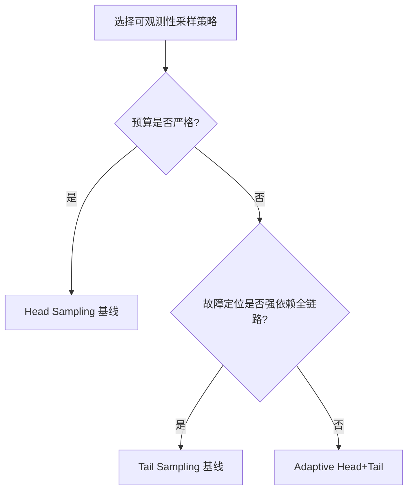
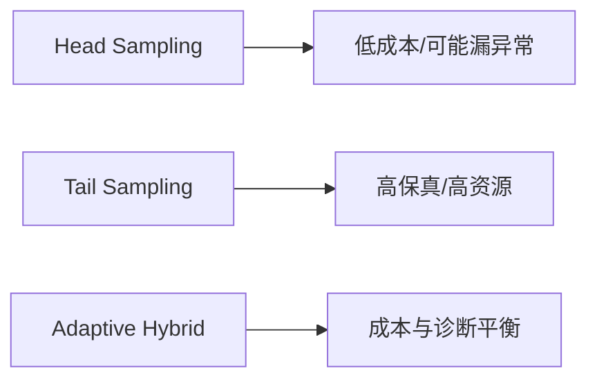
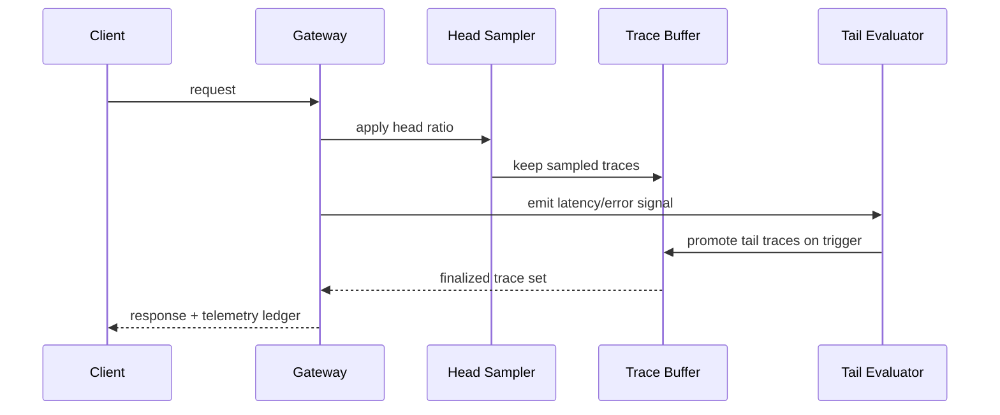

# Agent 可观测性采样策略选型 FAQ（Head Sampling vs Tail Sampling）

> 专题边界：仅讨论 **Agent 可观测性采样策略**（Trace/Span/事件采样），不扩展到身份注入、模型路由或供应链议题。

## 1) 📌 核心结论速览（3 条）

1. **生产默认建议“Head + Tail 混合采样”**：平时用 Head 控成本，异常由 Tail 兜底抓全链路。  
2. **纯 Head Sampling 成本最低但会漏掉低概率高损失故障**，尤其在多 Agent 协同时。  
3. **纯 Tail Sampling 诊断最完整但资源开销高**，必须配预算上限与回压策略。  

## 2) 🎯 Q1 / Q2 / Q3（大白话 + 第一性原理）

### Q1：Head Sampling 是什么？什么时候优先？

- **大白话**：请求一进来就“先抽样”，没抽中的请求后面不再保留完整追踪。  
- **第一性原理**：把观测成本前置裁剪，吞吐越大越需要早期降载。  
- **适用场景**：高吞吐、低故障率、预算敏感的常态流量。

### Q2：Tail Sampling 是什么？什么时候优先？

- **大白话**：先把追踪临时攒起来，等看到错误/高延迟再决定“全量保留哪条链路”。  
- **第一性原理**：诊断价值来自“结果导向”选择，异常链路信息密度最高。  
- **适用场景**：金融合规、故障复盘、跨服务跨 Agent 根因分析。

### Q3：核心技术 X（Adaptive Head+Tail）怎么运作？

- **大白话**：平时按比例先抽（Head），一旦触发异常规则就切到 Tail 补抓。  
- **第一性原理**：把“成本最优”和“诊断完备”拆成两个阶段，动态合并。  
- **链路**：入口 head 比例采样 → 聚合器暂存 → 触发器（error/latency/SLO）→ tail 保留异常全链路 → 网关预算与租户配额保护。

## 3) 🧭 Mermaid 可视化（决策树 TD + 路径 LR + 时序）

## 4) 📊 架构师决策矩阵

| 维度 | Head Sampling | Tail Sampling |
|---|---|---|
| 观测成本 | 低 | 高 |
| 异常捕获完整性 | 中-低 | 高 |
| 排障速度 | 中 | 高 |
| 实施复杂度 | 低 | 中-高 |
| 生产默认建议 | 常态流量基线 | 关键链路/合规链路 |

## 5) 🧪 定量算例 + 7-Card 洞察

> 数据来源：`evidence/cycle-405-benchmark.json`（按指标标注 `measured` / `synthetic` / `anonymized_reported`；未跑生产实验项标 `not_measured`）。

| 指标 | Head 基线 | Tail/Hybrid 基线 |
|---|---:|---:|
| 追踪成本（相对） | 1.0x | 2.7x |
| 异常链路捕获率 | 96.0% | 97.0% |
| 触发响应成功率 | 91.6% | 92.2% |
| 10x 负载主路径延迟 P95 | 158 ms | 158 ms |
| 单会话治理成本（20 分钟） | $0.00222（Wasm） | $0.00483（E2B） |

7-Card：`benchmark-cards.html` / `benchmark-cards.en.html`（4:5、自包含 CSP、坐标来自封存证据）

## 6) 🛠️ 生产核验 Checklist

- [ ] 按租户定义 head 采样比例与预算上限
- [ ] 配置 tail 触发条件（error/latency/SLO 违约）
- [ ] 采样策略变更前后都保留基准证据包
- [ ] 异常升级路径写入 MCP/A2A 统一审计
- [ ] 对热点租户启用动态回压与优先级策略
- [ ] 每周回放样本检查漏报率与误报率
- [ ] 在网关层验证“预算保护 + 诊断完整”双目标

