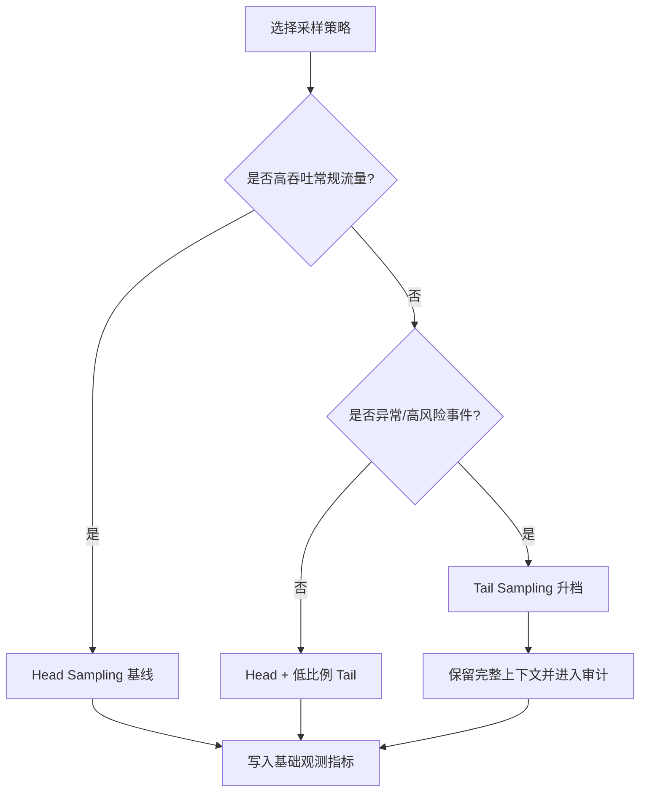
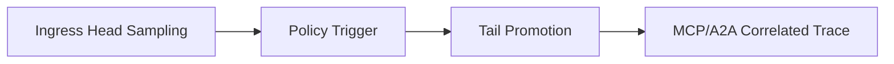
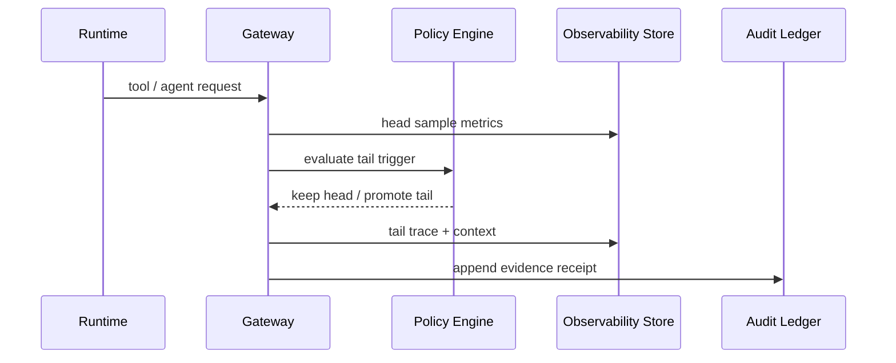

# Agent 可观测性采样策略选型 FAQ（Head Sampling vs Tail Sampling）

> 专题边界：仅讨论 Agent Runtime / MCP / A2A 链路中的**观测采样策略**，不讨论模型能力评测或 IAM 方案。

## 📌 核心结论速览（3 条）

1. **默认先上 Head Sampling 打底**：大白话就是“先保证每段流量都有基础可见性”，用较低成本获得全局温度计。  
2. **事故与高价值链路必须叠加 Tail Sampling**：第一性原理是“把有限观测预算集中给异常与关键路径”，提高故障定位有效密度。  
3. **生产推荐分层采样**：入口 Head、风险触发 Tail 升档、全链路审计落证，兼顾成本、吞吐和排障质量。

## 🎯 Q1：Head Sampling 与 Tail Sampling 的根本区别是什么？

- **大白话**：Head 是“先抽再跑”，Tail 是“先看结果再决定留不留”。  
- **第一性原理**：可观测系统的目标是用最小成本保留最大信息增益；Head 优先覆盖率，Tail 优先信息价值密度。

## 🎯 Q2：什么时候该选 Head？什么时候该选 Tail？

- **Head 优先**：高吞吐常规流量、SLO 看板、容量评估场景。  
- **Tail 优先**：错误激增、长尾延迟、跨租户合规事件、复杂工具编排失败。  
- **混合策略**：全量 Head 基线 + 规则触发 Tail（error / latency / policy hit / tenant priority）。

## 🎯 Q3：在 Azure Agent Infra 里怎么落地才可运营？

- **大白话**：先用便宜的“普查”，再对可疑样本“重点取证”，并把全过程记账。  
- **第一性原理**：采样策略必须和网关策略、租户预算、审计证据统一管理，否则会出现“看得见但管不住”或“管得住但看不见”。  
- **落地链路**：APIM/Envoy 收请求 -> Head 采样打点 -> 策略引擎判定 Tail 升档 -> MCP/A2A 关联追踪 -> 审计账本落证。

## 🧭 Mermaid（决策树 TD + 路径 LR + 时序）

## 📊 架构师决策矩阵

| 维度 | Head Sampling | Tail Sampling | 分层组合（推荐） |
|---|---|---|---|
| 观测覆盖率 | 高 | 中 | 高 |
| 异常取证质量 | 中 | 高 | 高 |
| 观测成本可控性 | 高 | 中 | 高 |
| 对吞吐影响 | 低 | 中 | 低-中 |
| 适配场景 | 常规大流量 | 异常与关键链路 | 多租户生产混合 |

## 🧪 定量算例 + 7-Card 4:5 洞察

| 指标 | Head 基线 | 分层采样基线 |
|---|---:|---:|
| 冷启动/恢复 P50 (ms) | 99 | 103 |
| 冷启动/恢复 P95 (ms) | 158 | 168 |
| 并发吞吐 P50 (rps) | 1680 | 1570 |
| 关键异常捕获率 | 94.0% | 96.3% |
| 单会话观测成本 (USD/20min) | 0.00483 | 0.00509 |

- 7-card 输出：`benchmark-cards.html` / `benchmark-cards.en.html`  
- 证据包：`evidence/cycle-413-benchmark.json`、`evidence/cycle-413-sources.json`  
- 标签：`measured / synthetic / anonymized_reported`（生产未跑指标统一标 `not_measured`）

## 🛠️ 生产核验 Checklist

- [ ] 定义 Head 采样基线比例与租户预算上限
- [ ] 定义 Tail 升档触发条件（error、latency、policy、tenant priority）
- [ ] 打通 APIM/Envoy 到 MCP/A2A 的 trace correlation ID
- [ ] 采样决策与落证写入审计账本（可回放、可追责）
- [ ] 7-card 所有坐标均有封存证据；缺失项显式标 `not_measured`
