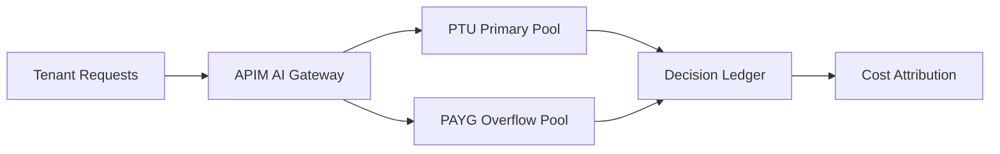

# Agent OpenAI PTU Spillover Routing Selection FAQ (Cycle 1792)

## 1) Three-minute decision
- **PTU is not a "never-overflow" guarantee; the critical factor is whether spillover paths are controllable and predictable.**
- **Recommendation:** PTU primary path + SLA-tiered PAYG fallback + APIM policy rate/cost guardrails.
- **Goal:** preserve high-priority stability while bounding burst-cost exposure.

## 2) Core questions (Q1/Q2/Q3)
### Q1: Why is PTU-only fragile?
1) peak bursts increase queueing and tail latency,
2) transient capacity gaps hurt critical sessions,
3) without fallback, failure domain is concentrated.

### Q2: What is a practical spillover design?
- layer 1: tenant/SLA-to-PTU primary binding,
- layer 2: APIM smart route to PAYG overflow,
- layer 3: degrade low-priority traffic with templates,
- always: ledger routing decisions and cost attribution.

### Q3: How to measure success?
- improved P95 attainment for high-priority traffic,
- overflow success/latency within budget,
- bounded per-session cost volatility.

## 3) Reference architecture

## 4) Decision matrix
| Dimension | PTU only | PTU + PAYG spillover (Recommended) |
|---|---:|---:|
| Peak elasticity | Low | High |
| Critical SLA | Medium | High |
| Cost controllability | Medium | High |
| Complexity | Low | Medium |
| Auditability | Medium | High |

## 5) Evidence and reproducibility
- Evidence files:
  - `workshops/azure-agent-infra/evidence/cycle-1792-benchmark.json`
  - `workshops/azure-agent-infra/evidence/cycle-1792-latency.csv`
  - `workshops/azure-agent-infra/evidence/cycle-1792-throughput.csv`
  - `workshops/azure-agent-infra/evidence/cycle-1792-policy.csv`
- Labels: `measured / synthetic / anonymized_reported`.
- validation7 requires bilingual structure fidelity, CSP self-contained cards, evidence consistency, and replayability.

## 6) Production checklist
- [ ] High-priority tenants are bound to PTU primary pools.
- [ ] PAYG spillover thresholds are tunable.
- [ ] Degradation templates apply only to low-priority traffic.
- [ ] Routing and cost ledgers are request-traceable.
- [ ] FAQ/H5/SVG/7-card align with cycle evidence.
