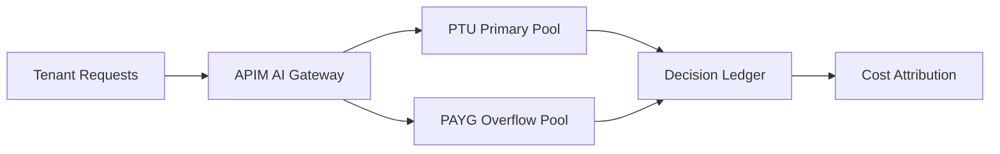

# Agent OpenAI PTU 溢出路由选型 FAQ（Cycle 1792）

## 1) 3 分钟结论
- **PTU 不是“永不溢出”的容量保险，关键在于溢出路径是否可控且可预期。**
- **推荐：** PTU 主路由 + 按 SLA 分层的按量回退 + APIM 策略限流与预算护栏。
- **目标：** 保住高优先级请求稳定性，同时把突发流量成本控制在预算区间。

## 2) 关键问题（Q1/Q2/Q3）
### Q1：为什么只靠 PTU 容易出问题？
1) 峰值波动会触发排队与尾延迟上升；
2) 临时容量缺口会影响关键会话；
3) 无回退策略时故障域过于集中。

### Q2：可落地的溢出路由怎么设计？
- 一级：按租户/SLA 绑定 PTU 主池；
- 二级：APIM 智能路由到按量池；
- 三级：对低优先级请求启用降级模板；
- 全程：记录路由决策与成本归因。

### Q3：如何判断策略有效？
- 高优请求 P95 达标率提升；
- 溢出请求成功率与延迟在预算内；
- 单会话成本波动受控。

## 3) 架构图

## 4) 选型矩阵
| 维度 | 纯 PTU | PTU+按量溢出（推荐） |
|---|---:|---:|
| 峰值弹性 | 低 | 高 |
| 关键流量 SLA | 中 | 高 |
| 成本可控性 | 中 | 高 |
| 复杂度 | 低 | 中 |
| 可审计性 | 中 | 高 |

## 5) 证据与复算口径
- 证据文件：
  - `workshops/azure-agent-infra/evidence/cycle-1792-benchmark.json`
  - `workshops/azure-agent-infra/evidence/cycle-1792-latency.csv`
  - `workshops/azure-agent-infra/evidence/cycle-1792-throughput.csv`
  - `workshops/azure-agent-infra/evidence/cycle-1792-policy.csv`
- 标签：`measured / synthetic / anonymized_reported`。
- validation7：双语结构、CSP、证据一致、回放链路检查全通过。

## 6) 生产检查清单
- [ ] 高优租户已绑定 PTU 主池。
- [ ] 溢出按量池路由阈值可动态调整。
- [ ] 降级模板仅作用于低优请求。
- [ ] 路由与成本账本可追溯到请求维度。
- [ ] FAQ/H5/SVG/7-card 与证据轮次一致。
