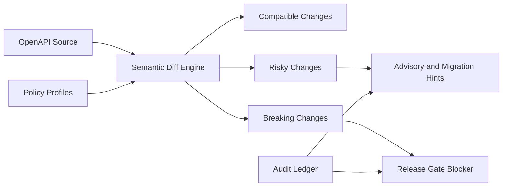

# OpenAPI Contract Diff Gate Selection FAQ (Cycle 1853)

## 1) Three-minute decision
- **Core tradeoff:** API iteration is fast, but without contract-diff gates, hidden breaking changes cascade across agent call chains.
- **Recommendation:** semantic diff tiers (compatible/risky/breaking), pre-release blocking, and automated migration hints.
- **Goal:** keep API evolution safe without slowing delivery cadence.

## 2) Q1 / Q2 / Q3
### Q1: Why are unit tests alone insufficient?
1) tests often validate implementation paths, not external contracts,
2) optional-field semantic shifts surface only at runtime,
3) multi-language SDK and agent-tool chains are sensitive to breaking changes.

### Q2: What production-grade contract-diff gate should be used?
- **Semantic tiering:** classify changes as compatible, risky, or breaking,
- **Release blocking:** breaking changes require migration plan or version split,
- **Auto advisories:** generate compatibility impact and remediation hints,
- **Waiver audit:** emergency waivers require dual approval and ledger logging.

### Q3: How do we validate gate effectiveness?
- lower missed-breaking-change rate,
- fewer post-release compatibility incidents and rollbacks,
- predictable and traceable migration cycles.

## 3) Reference architecture

## 4) Decision matrix
| Dimension | Unit-tests only | Tiered contract-diff gate (Recommended) |
|---|---:|---:|
| Breaking-change detection | Low | High |
| Release safety | Medium | High |
| Migration traceability | Low | High |
| Implementation complexity | Low | Medium |
| Delivery stability | Medium | High |

## 5) Evidence and reproducibility
- Evidence files:
  - `workshops/azure-agent-infra/evidence/cycle-1853-benchmark.json`
  - `workshops/azure-agent-infra/evidence/cycle-1853-latency.csv`
  - `workshops/azure-agent-infra/evidence/cycle-1853-throughput.csv`
  - `workshops/azure-agent-infra/evidence/cycle-1853-policy.csv`
- Labels: `measured / synthetic / anonymized_reported`.
- validation7 enforces bilingual six-part structure, CSP self-contained 7-card output, strict cycle-evidence alignment, and replayability.

## 6) Production checklist
- [ ] Semantic diff-tier rules are frozen.
- [ ] Breaking-change release blocker and version-split flow are active.
- [ ] Auto migration advisories cover critical consumers.
- [ ] Dual-approval waiver trail is auditable.
- [ ] FAQ/H5/SVG/7-card align with cycle evidence.
