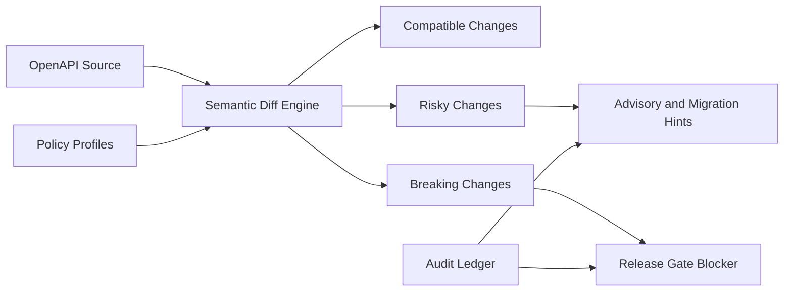

# OpenAPI Contract Diff 门禁选型 FAQ（Cycle 1853）

## 1) 3 分钟结论
- **核心矛盾：** API 迭代速度快，但若缺少契约差异门禁，生产会出现隐性破坏性变更并连锁影响 Agent 调用链。
- **推荐：** 语义级 diff 分级（兼容/风险/破坏）+ 发布前阻断 + 自动迁移提示。
- **目标：** 保障接口演进可控，在不拖慢交付的前提下降低线上兼容性事故。

## 2) Q1 / Q2 / Q3
### Q1：为什么“只跑单测”不足以覆盖契约风险？
1) 单测覆盖常聚焦实现路径，遗漏对外契约变化；
2) 可选字段语义变化在运行时才暴露；
3) 多语言 SDK 与 Agent 工具调用链对破坏性变更高度敏感。

### Q2：生产级 Contract Diff 门禁怎么做？
- **语义分级：** 将变更分为兼容、风险、破坏三级；
- **发布阻断：** 破坏级变更必须附迁移计划或版本分叉；
- **自动提示：** 为调用方生成兼容性影响与修复建议；
- **豁免审计：** 紧急豁免需双签并记录到审计链。

### Q3：如何验证门禁策略有效？
- 破坏性变更漏检率下降；
- 发布后兼容性事故与回滚次数下降；
- 版本迁移周期可预测且可追踪。

## 3) 架构图

## 4) 选型矩阵
| 维度 | 仅单测校验 | Contract Diff 分级门禁（推荐） |
|---|---:|---:|
| 破坏性检测 | 低 | 高 |
| 发布安全性 | 中 | 高 |
| 迁移可追踪性 | 低 | 高 |
| 实施复杂度 | 低 | 中 |
| 交付稳定性 | 中 | 高 |

## 5) 证据与复算口径
- 证据文件：
  - `workshops/azure-agent-infra/evidence/cycle-1853-benchmark.json`
  - `workshops/azure-agent-infra/evidence/cycle-1853-latency.csv`
  - `workshops/azure-agent-infra/evidence/cycle-1853-throughput.csv`
  - `workshops/azure-agent-infra/evidence/cycle-1853-policy.csv`
- 标签：`measured / synthetic / anonymized_reported`。
- validation7：双语六段结构、7-card CSP 自包含、轮次与 evidence 一致、可回放链路通过。

## 6) 生产检查清单
- [ ] 语义 diff 分级规则已冻结。
- [ ] 破坏级发布阻断与版本分叉流程已打通。
- [ ] 自动迁移提示覆盖关键调用方。
- [ ] 紧急豁免双签审计链可追溯。
- [ ] FAQ/H5/SVG/7-card 与 evidence 轮次一致。
