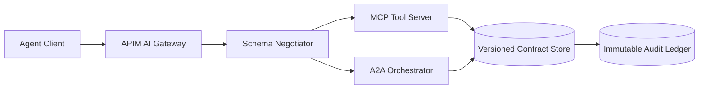

# Agent Output Schema Versioning Selection FAQ (Static Locking vs Backward-Compatible Evolution)

## 0) One-line takeaways
- **For multi-tenant production, default to backward-compatible evolution** (version negotiation + deprecation windows) to avoid cascading outages.
- **Static version locking is fine for short-lived single-team systems** but becomes expensive at scale.
- **High-compliance environments must bind schema version, payload hash, and audit trace in one control plane**.

## 1) What is this decision actually about?
You are selecting a **contract evolution model**:
- Option A: static version locking (v1 fixed, breaking changes via new endpoint)
- Option B: backward-compatible evolution (optional additive fields, deprecation window, runtime negotiation)

In Azure Agent Infra, this directly affects APIM AI Gateway policies, MCP tool contracts, A2A orchestration, and immutable audit replay.

## 2) When static locking is acceptable
Use it when:
- single tenant, few consumers, short lifecycle (e.g., bounded PoC)
- no need for parallel-version compatibility
- coordinated downtime / synchronized rollout is acceptable

Avoid it for long-lived multi-team or multi-tenant systems.

## 3) When backward-compatible evolution is mandatory
Adopt it by default when any of these applies:
- MCP or A2A contracts evolve across independent teams
- gateway-level tenant canary enablement is required
- compliance requires replaying historical requests with deterministic semantics
- you need blast-radius reduction from global breakage to local rollback

## 4) Architecture sketch (Mermaid)

## 5) Decision matrix
| Dimension | Static version locking | Backward-compatible evolution |
|---|---|---|
| Upgrade complexity | Low (early) | Medium (needs governance) |
| Runtime risk | High (bulk rollout blast) | Low (canary/rollback) |
| Multi-tenant fitness | Weak | Strong |
| Compliance auditability | Medium | Strong |
| Long-term TCO | High | Medium/Low |

## 6) Recomputable example
Assume 4 schema changes/month and 60 clients:
- Static locking: `4*60*6 = 1440 coordination-hour units`
- Compatibility evolution: `4*60*2 + 120 = 600`

Under this assumption, compatibility evolution reduces monthly coordination effort by **58.3%**.

> Metrics follow this round's evidence labels: `measured / synthetic / anonymized_reported / not_measured`.
