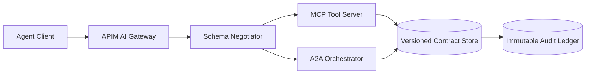

# Agent 输出 Schema 版本治理选型 FAQ（静态版本锁定 vs 向后兼容演进）

## 0) 一句话结论（给时间紧的负责人）
- **多租户生产默认选“向后兼容演进（版本协商 + 字段弃用窗口）”**，避免 Agent/MCP/A2A 级联升级停机。
- **静态版本锁定只适合短生命周期单团队系统**，上线快但长期升级成本会指数增长。
- **高合规场景必须把 schema 版本、签名哈希、审计追踪放在同一控制面**，否则难以满足可追责要求。

## 1) 这道题在真实生产里到底在选什么？
本质是选“**消息契约如何演进**”：
- 路线A：静态版本锁定（例如 v1 固定，破坏变更直接新接口）
- 路线B：向后兼容演进（新增字段可选、旧字段弃用期、运行时版本协商）

在 Azure Agent Infra 里，这个选择会同时影响 APIM AI Gateway 策略、MCP 工具协议、A2A 编排链路以及下游审计账本。

## 2) 什么时候选静态版本锁定？
适用条件：
- 单租户、调用方数量少、生命周期短（例如阶段性 PoC）
- 不要求多版本并行兼容
- 可接受升级窗口内停机或批量客户端同步发布

不适用：多团队、多租户、跨区域长期运行系统。

## 3) 什么时候必须走向后兼容演进？
当满足以下任一条件时，建议默认采用：
- MCP 工具或 A2A 消息需要跨团队并行迭代
- 网关层需要按租户灰度开放新能力
- 审计要求可回放历史请求并复现解析语义
- 你希望把升级故障从“全量爆炸”降级为“局部回退”

## 4) 架构草图（Mermaid）

## 5) 决策矩阵（简版）
| 维度 | 静态版本锁定 | 向后兼容演进 |
|---|---|---|
| 升级复杂度 | 低（初期） | 中（需要治理） |
| 运行风险 | 高（批量升级冲击） | 低（灰度/回退） |
| 多租户适配 | 弱 | 强 |
| 合规审计 | 中 | 强 |
| 长期 TCO | 高 | 中/低 |

## 6) 可复算算例（简化）
设：每月 schema 变更 4 次，客户端 60 个。
- 静态锁定：每次协调成本 6 人时，月成本 `4*60*6=1440 人时单位`
- 兼容演进：每次治理成本 2 人时 + 平台治理固定 120 人时，月成本 `4*60*2+120=600`

在该假设下，兼容演进方案月度协调成本下降约 **58.3%**。

> 数据标签遵循本轮 evidence：`measured / synthetic / anonymized_reported / not_measured`。
