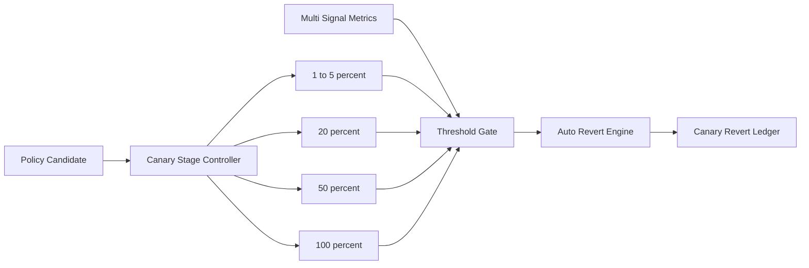

# Agent Policy Canary Revert Threshold Selection FAQ (Cycle 1837)

## 1) Three-minute decision
- **Core tension:** conservative canary rollout slows delivery, while aggressive rollout amplifies policy defects into full production.
- **Recommendation:** multi-signal threshold gates plus staged rollout plus automatic revert triggers.
- **Goal:** accelerate policy release under bounded risk and minimize blast radius on failure.

## 2) Q1 / Q2 / Q3
### Q1: Why do single-metric revert thresholds fail?
1) error-rate alone cannot distinguish jitter from sustained incidents,
2) traffic-mix shifts distort fixed thresholds,
3) missing business-quality signals may pass technical checks but degrade user outcomes.

### Q2: What production-ready canary revert strategy should be used?
- **Multi-signal gate:** error rate, latency, deny rate, and business success rate,
- **Staged rollout:** 1% to 5% to 20% to 50% to 100% with minimum dwell windows,
- **Auto-revert:** immediate rollback on sustained threshold breach,
- **Cooldown window:** freeze re-rollout after rollback to avoid oscillation.

### Q3: How do we validate fast release with low risk?
- higher successful rollout completion rate,
- shorter revert trigger latency,
- lower recovery time and complaint rate after rollback.

## 3) Reference architecture

## 4) Decision matrix
| Dimension | Fixed-threshold rollout | Multi-signal revert gate (Recommended) |
|---|---:|---:|
| Delivery speed | Medium | Medium-high |
| Risk controllability | Low | High |
| Misfire control | Low | High |
| Implementation complexity | Low | Medium |
| Operational explainability | Medium | High |

## 5) Evidence and reproducibility
- Evidence files:
  - `workshops/azure-agent-infra/evidence/cycle-1837-benchmark.json`
  - `workshops/azure-agent-infra/evidence/cycle-1837-latency.csv`
  - `workshops/azure-agent-infra/evidence/cycle-1837-throughput.csv`
  - `workshops/azure-agent-infra/evidence/cycle-1837-policy.csv`
- Labels: `measured / synthetic / anonymized_reported`.
- validation7 enforces bilingual six-part structure, CSP self-contained 7-card output, strict cycle-evidence alignment, and replayability.

## 6) Production checklist
- [ ] Staged rollout ratios and dwell windows are fixed.
- [ ] Multi-signal thresholds and weights are integrated.
- [ ] Auto-revert and cooldown chains are validated.
- [ ] Revert ledger and alerting are traceable.
- [ ] FAQ/H5/SVG/7-card align with cycle evidence.
