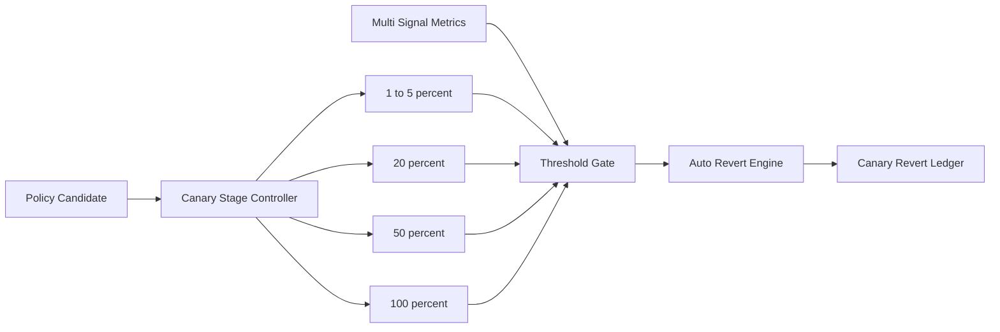

# Agent 策略金丝雀回滚阈值选型 FAQ（Cycle 1837）

## 1) 3 分钟结论
- **核心矛盾：** 金丝雀放量太保守会拖慢变更节奏，太激进会把策略缺陷快速放大到全量。
- **推荐：** 多信号阈值门禁 + 分段放量 + 自动回滚触发。
- **目标：** 在可控风险下加速策略发布，并把失败影响面限制在最小范围。

## 2) Q1 / Q2 / Q3
### Q1：为什么单指标回滚阈值容易失真？
1) 单一错误率无法区分短时抖动与持续故障；
2) 流量结构变化会造成阈值误判；
3) 未纳入业务质量指标会导致技术达标但体验退化。

### Q2：可落地的金丝雀回滚阈值策略是什么？
- **多信号门禁**：错误率、延迟、策略拒绝率、业务成功率联合判断；
- **分段放量**：1%→5%→20%→50%→100%，每段设最短观察窗口；
- **自动回滚**：连续超阈值立即回退上一稳定版本；
- **冷却窗口**：回滚后冻结再次放量，避免抖动重试。

### Q3：如何验证“快发布且低风险”？
- 放量成功率提升；
- 回滚触发时延缩短；
- 回滚后服务恢复时间与用户投诉率下降。

## 3) 架构图

## 4) 选型矩阵
| 维度 | 固定阈值放量 | 多信号回滚门禁（推荐） |
|---|---:|---:|
| 发布速度 | 中 | 中高 |
| 风险可控性 | 低 | 高 |
| 误判率控制 | 低 | 高 |
| 实施复杂度 | 低 | 中 |
| 运营可解释性 | 中 | 高 |

## 5) 证据与复算口径
- 证据文件：
  - `workshops/azure-agent-infra/evidence/cycle-1837-benchmark.json`
  - `workshops/azure-agent-infra/evidence/cycle-1837-latency.csv`
  - `workshops/azure-agent-infra/evidence/cycle-1837-throughput.csv`
  - `workshops/azure-agent-infra/evidence/cycle-1837-policy.csv`
- 标签：`measured / synthetic / anonymized_reported`。
- validation7：双语六段结构、7-card CSP 自包含、轮次与 evidence 一致、可回放链路通过。

## 6) 生产检查清单
- [ ] 分段放量比例与观察窗口已固化。
- [ ] 多信号阈值与权重策略已联调。
- [ ] 自动回滚和冷却窗口链路已演练。
- [ ] 回滚账本与告警可追溯。
- [ ] FAQ/H5/SVG/7-card 与 evidence 轮次一致。
