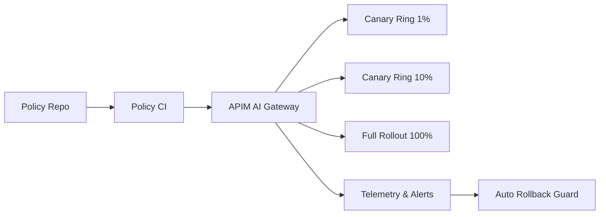

# Agent Policy Canary Rollout Selection FAQ (Big-Bang Switch vs Phased Canary)

## 0) Executive takeaway
- **Default to phased canary rollout in production** to cap blast radius of false positives/false negatives.
- **Big-bang switch is acceptable only for low-risk, fast-rollback systems**.
- **For regulated multi-tenant workloads, rollout ratio, rollback threshold, and audit evidence must be coupled automatically**.

## 1) What this decision means
You are choosing policy release semantics:
- Big-bang: fast, but failures hit everyone.
- Canary: slightly slower, but observable, reversible, and tenant-ramp friendly.

## 2) When big-bang can still work
- low-risk internal environments
- narrow policy scope
- strong rollback path in minutes

## 3) When canary is mandatory
- content-safety or privilege boundaries involved
- tenant tiers have different SLA/risk appetite
- audit evidence is required for who/when/rollout percentage

## 4) Architecture sketch

## 5) Decision matrix
| Dimension | Big-bang switch | Canary rollout |
|---|---|---|
| Release speed | High | Medium |
| Incident blast radius | High | Low |
| Observable rollback | Medium | High |
| Compliance explainability | Medium | High |
| Long-term stability | Medium | High |

## 6) Recomputable example
Assume 12 policy releases/month and failure impact cost=100:
- Big-bang failure rate 6% => `12*0.06*100 = 72`
- Canary failure rate 2% and 60% lower blast => `12*0.02*40 = 9.6`

Expected failure cost reduction is **86.7%**.
