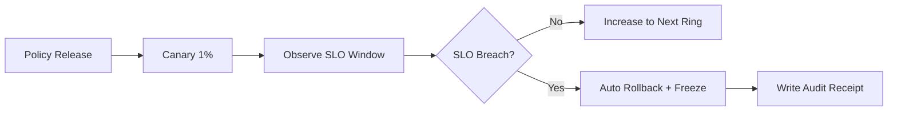

# Agent Policy Canary Gate FAQ (Fixed Ramp Ratio vs SLO-Triggered Auto-Rollback)

> **Relation to Round17**: Round17 answered whether to use canary rollout at all. This round is a scoped extension: once canary is chosen, should release gates be fixed ratios or SLO-driven auto-rollback?

## 1) Core conclusions
- **Use SLO-triggered auto-rollback by default in multi-tenant production** rather than ratio-only ramping.
- **Fixed-ratio ramping is only acceptable for low-risk policy changes** where rollback is immediate.
- **Gate automation must combine three signals**: false-positive interception rate, downstream 5xx rate, and tenant complaint rate.

## 2) Q1 / Q2 / Q3 (plain-language terms first)
- **Ramp ratio**: gradually exposing a new policy to 1%/5%/10% traffic.
- **SLO gate**: stopping promotion (or rolling back) when key quality indicators cross thresholds.

### Q1: Why is ratio-only gating insufficient?
First principle: ratio controls blast radius only; it does not tell you whether policy quality is acceptable. Quality requires outcome metrics.

### Q2: When is fixed-ratio gating still acceptable?
Only for low-risk paths with minute-level rollback and no high-impact compliance implications.

### Q3: What is the minimal SLO gate control loop?
Release batch -> observation window -> threshold evaluation -> auto pause/rollback -> audit receipt.

## 3) Mermaid (gate execution path)

## 4) Decision matrix (scope of this round)
| Dimension | Fixed-ratio ramp | SLO-driven gate |
|---|---|---|
| Configuration complexity | Low | Medium |
| Risk convergence speed | Medium | High |
| False-positive containment | Low | High |
| Compliance explainability | Medium | High |
| Default fit | Low-risk non-critical paths | Multi-tenant production |

## 5) Evidence contract + recomputable example (with n/denominator/source)
> All percentages in this section are **synthetic_assumed**; production traffic validation is **not_measured**.  
> Field contract path: `workshops/azure-agent-infra/evidence/cycle-416-benchmark.json` -> `percentage_contract`.

- Metric A (false-positive rollback trigger rate)  
  - Formula: `n_triggered / n_releases`  
  - Assumed values: `9/120 = 7.5%`  
  - Path: `percentage_contract.policy_gate_false_positive_trigger_rate`
- Metric B (incident spread under fixed-ratio ramp)  
  - Formula: `n_incidents_spread / n_incidents_total`  
  - Assumed values: `31/120 = 25.8%`  
  - Path: `percentage_contract.fixed_rollout_blast_spread_rate`
- Metric C (incident spread under SLO gate)  
  - Formula: `n_incidents_spread / n_incidents_total`  
  - Assumed values: `11/120 = 9.2%`  
  - Path: `percentage_contract.slo_gate_blast_spread_rate`

## 6) Production checklist
- [ ] Gate thresholds are set for false-positive rate, 5xx rate, and complaint rate  
- [ ] Each threshold has a window, trigger, and automated action  
- [ ] Rollback path completes within 5 minutes with auditable receipts  
- [ ] This round is labeled `synthetic_assumed`; production validation remains `not_measured`  
