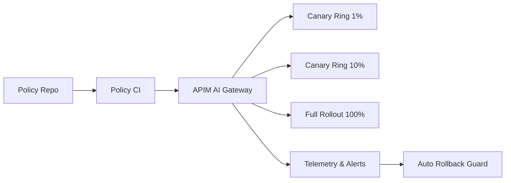

# Agent 策略灰度发布选型 FAQ（一次性全量切换 vs 分阶段 Canary Rollout）

## 0) 一句话结论
- **生产默认选分阶段 Canary Rollout**：把策略误杀/漏拦截影响限制在小流量窗口。
- **一次性全量切换只适合低风险、可快速回滚的小系统**。
- **多租户高合规必须把灰度比例、回滚阈值、审计证据自动化联动**。

## 1) 这道题在选什么
你在选择“策略变更如何上线”：
- 全量切换：快，但出错就是全域影响。
- Canary：慢一点，但可观测、可回退、可逐租户放量。

## 2) 何时还能用一次性切换
- 内部低风险环境
- 规则简单、影响面小
- 已有强回滚并可在分钟级完成

## 3) 何时必须 Canary
- 涉及内容安全/越权拦截
- 租户分层 SLA 不一致
- 需要审计证据证明“何时、对谁、生效比例”

## 4) Mermaid 架构

## 5) 决策矩阵
| 维度 | 全量切换 | Canary Rollout |
|---|---|---|
| 上线速度 | 高 | 中 |
| 事故半径 | 高 | 低 |
| 可观测回滚 | 中 | 高 |
| 合规可解释性 | 中 | 高 |
| 长期稳定性 | 中 | 高 |

## 6) 可复算算例
假设月均策略发布 12 次，单次故障影响成本 100 单位：
- 全量切换故障率 6%，预期成本 `12*0.06*100=72`
- Canary 故障率 2%，且事故半径降 60%，成本 `12*0.02*40=9.6`

预期故障成本下降约 **86.7%**。
