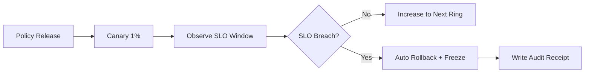

# Agent 策略灰度门禁阈值选型 FAQ（固定比例放量 vs SLO 触发自动回滚）

> **与 Round17 的关系**：Round17 决策“是否采用灰度发布”；本轮聚焦其子题——采用灰度后，门禁阈值该用固定比例还是用 SLO 动态回滚。

## 1) 核心结论（先给负责人）
- **多租户生产默认用“SLO 触发自动回滚”**，不是只盯放量百分比。
- **固定比例放量只适合低风险策略**，一旦误杀规则上线，损失会被放量放大。
- **门禁必须绑定三类指标**：拦截误报率、下游 5xx、租户投诉率；缺一不可。

## 2) Q1 / Q2 / Q3（术语先通俗解释）
- **放量比例**：把新策略先给 1%/5%/10% 流量试跑。
- **SLO 门禁**：若关键指标越过阈值，系统自动停止继续放量并回滚。

### Q1：为什么“只看放量比例”不够？
第一性原理：比例只是“影响范围”，不是“质量好坏”。质量要看误报、延迟、错误率三类结果指标。

### Q2：什么情况下固定比例仍可接受？
当策略只影响低风险路径，且可在分钟级快速回滚；否则建议改成 SLO 动态门禁。

### Q3：SLO 动态门禁的最小闭环是什么？
发布批次 -> 观测窗口 -> 阈值判断 -> 自动暂停/回滚 -> 形成审计回执；这一闭环必须自动化。

## 3) Mermaid（门禁执行路径）

## 4) 决策矩阵（本轮子题边界）
| 维度 | 固定比例放量 | SLO 动态门禁 |
|---|---|---|
| 配置复杂度 | 低 | 中 |
| 风险收敛速度 | 中 | 高 |
| 误报止损能力 | 低 | 高 |
| 合规可解释性 | 中 | 高 |
| 适用默认 | 非关键低风险 | 多租户生产默认 |

## 5) 数据证据与可复算算例（含 n/分母/来源）
> 本节百分比均为 **synthetic_assumed**，生产真实流量标记为 **not_measured**。  
> 合同字段见：`workshops/azure-agent-infra/evidence/cycle-416-benchmark.json` 的 `percentage_contract`。

- 指标 A（误报回滚触发率）  
  - 定义：`n_triggered / n_releases`  
  - 假设：`n_triggered=9`, `n_releases=120` -> `7.5%`  
  - 路径：`percentage_contract.policy_gate_false_positive_trigger_rate`
- 指标 B（固定比例下事故扩散率）  
  - 定义：`n_incidents_spread / n_incidents_total`  
  - 假设：`31/120` -> `25.8%`  
  - 路径：`percentage_contract.fixed_rollout_blast_spread_rate`
- 指标 C（SLO 门禁下事故扩散率）  
  - 定义：`n_incidents_spread / n_incidents_total`  
  - 假设：`11/120` -> `9.2%`  
  - 路径：`percentage_contract.slo_gate_blast_spread_rate`

## 6) 生产 Checklist（是否可上线）
- [ ] 已定义三类门禁指标：误报率、5xx、投诉率  
- [ ] 每个门禁指标都有阈值、观测窗口、自动动作  
- [ ] 回滚路径可在 5 分钟内完成且留有审计回执  
- [ ] 本轮数据标记为 `synthetic_assumed`，生产验证状态为 `not_measured`  
