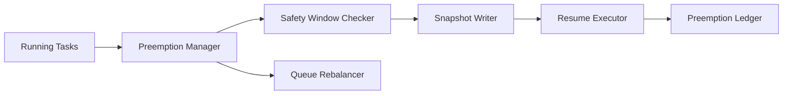

# Agent Preemption Safety Window Selection FAQ (Cycle 1810)

## 1) Three-minute decision
- **Preemption failures are usually caused not by weak scheduling, but by missing safe-switch window definitions.**
- **Recommendation:** interrupt-point annotations + safety-window preemption + snapshot-based replay guarantees.
- **Goal:** improve throughput under pressure without breaking consistency on critical steps.

## 2) Q1 / Q2 / Q3
### Q1: Why is "preempt anytime" risky?
1) critical-step interruption is hard to recover,
2) external side effects may be duplicated,
3) session context can drift or be lost.

### Q2: What practical safety-window policy works?
- annotate interruptible points by stage,
- allow preemption only within safe windows,
- write minimal snapshot before preemption,
- verify snapshot version and idempotency key on resume.

### Q3: How to validate effectiveness?
- higher resume success after preemption,
- fewer inconsistency incidents,
- improved resource utilization and throughput.

## 3) Reference architecture

## 4) Decision matrix
| Dimension | Preempt anytime | Safety-window preemption (Recommended) |
|---|---:|---:|
| Resume success | Medium | High |
| Consistency risk | High | Low |
| Throughput gain | Medium | High |
| Implementation complexity | Low | Medium |
| Auditability | Medium | High |

## 5) Evidence and reproducibility
- Evidence files:
  - `workshops/azure-agent-infra/evidence/cycle-1810-benchmark.json`
  - `workshops/azure-agent-infra/evidence/cycle-1810-latency.csv`
  - `workshops/azure-agent-infra/evidence/cycle-1810-throughput.csv`
  - `workshops/azure-agent-infra/evidence/cycle-1810-policy.csv`
- Labels: `measured / synthetic / anonymized_reported`.
- validation7 requires bilingual structure fidelity, CSP self-contained cards, cycle-consistent evidence, and replayability checks.

## 6) Production checklist
- [ ] Stage-level interrupt points are defined.
- [ ] Preemption snapshot includes minimum required fields.
- [ ] Resume checks include version and idempotency key.
- [ ] Preemption audit and rollback drills are executable.
- [ ] FAQ/H5/SVG/7-card align with cycle evidence.
