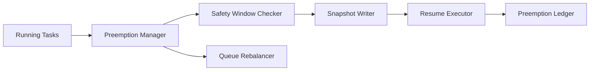

# Agent 抢占安全窗口选型 FAQ（Cycle 1810）

## 1) 3 分钟结论
- **抢占失败通常不是调度器能力不足，而是缺少“安全切换窗口”定义。**
- **推荐：** 可中断点标注 + 安全窗口抢占 + 状态快照回放保障。
- **目标：** 在资源紧张时提升吞吐，同时避免中断关键步骤造成不一致。

## 2) Q1 / Q2 / Q3
### Q1：为什么“随时抢占”风险高？
1) 关键步骤中断后难以恢复；
2) 外部副作用可能重复触发；
3) 会话上下文可能丢失或错位。

### Q2：可落地安全窗口策略是什么？
- 任务阶段标记可中断点；
- 仅在安全窗口允许抢占迁移；
- 抢占前写入最小状态快照；
- 恢复时校验快照版本与幂等键。

### Q3：如何验证策略有效？
- 抢占后恢复成功率提升；
- 抢占导致的不一致事件下降；
- 资源利用率与吞吐同步改善。

## 3) 架构图

## 4) 选型矩阵
| 维度 | 任意时刻抢占 | 安全窗口抢占（推荐） |
|---|---:|---:|
| 恢复成功率 | 中 | 高 |
| 一致性风险 | 高 | 低 |
| 吞吐提升 | 中 | 高 |
| 实施复杂度 | 低 | 中 |
| 可审计性 | 中 | 高 |

## 5) 证据与复算口径
- 证据文件：
  - `workshops/azure-agent-infra/evidence/cycle-1810-benchmark.json`
  - `workshops/azure-agent-infra/evidence/cycle-1810-latency.csv`
  - `workshops/azure-agent-infra/evidence/cycle-1810-throughput.csv`
  - `workshops/azure-agent-infra/evidence/cycle-1810-policy.csv`
- 标签：`measured / synthetic / anonymized_reported`。
- validation7：双语结构、CSP 自包含、证据轮次一致、可回放链路校验通过。

## 6) 生产检查清单
- [ ] 阶段级可中断点已定义。
- [ ] 抢占前快照最小字段完整。
- [ ] 恢复校验含版本号与幂等键。
- [ ] 抢占审计与回滚路径可演练。
- [ ] FAQ/H5/SVG/7-card 与 evidence 轮次一致。
