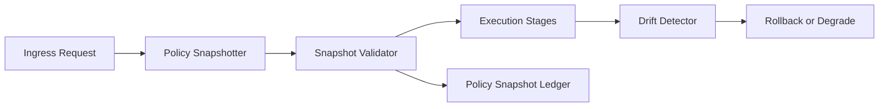

# Agent Preflight Policy Snapshot Selection FAQ (Cycle 1807)

## 1) Three-minute decision
- **Release incidents often come from policy drift during execution, not missing policy definitions.**
- **Recommendation:** freeze policy snapshots at preflight + execution-time consistency checks + drift-triggered rollback.
- **Goal:** ensure one request uses one policy view across all execution stages.

## 2) Q1 / Q2 / Q3
### Q1: Why is live policy read risky?
1) policy versions may change during request lifetime,
2) node timing differences cause inconsistent decisions,
3) post-incident replay lacks exact policy context.

### Q2: What snapshot approach is practical?
- generate snapshot ID at ingress,
- read frozen rules by snapshot ID during execution,
- attach snapshot-signature validation at key decisions,
- trigger block or degrade rollback on drift detection.

### Q3: How to validate effectiveness?
- higher policy decision consistency,
- lower drift-induced misclassification,
- faster incident reconstruction.

## 3) Reference architecture

## 4) Decision matrix
| Dimension | Live policy read | Preflight snapshot (Recommended) |
|---|---:|---:|
| Decision consistency | Low | High |
| Drift controllability | Low | High |
| Replay explainability | Medium | High |
| Implementation complexity | Low | Medium |
| Risk isolation | Medium | High |

## 5) Evidence and reproducibility
- Evidence files:
  - `workshops/azure-agent-infra/evidence/cycle-1807-benchmark.json`
  - `workshops/azure-agent-infra/evidence/cycle-1807-latency.csv`
  - `workshops/azure-agent-infra/evidence/cycle-1807-throughput.csv`
  - `workshops/azure-agent-infra/evidence/cycle-1807-policy.csv`
- Labels: `measured / synthetic / anonymized_reported`.
- validation7 requires bilingual structure fidelity, CSP self-contained cards, cycle-consistent evidence, and replayability checks.

## 6) Production checklist
- [ ] Preflight snapshot ID propagates end-to-end.
- [ ] Frozen-rule reads are enforced during execution.
- [ ] Snapshot signature failures can block execution.
- [ ] Drift events are auditable with automatic rollback.
- [ ] FAQ/H5/SVG/7-card align with cycle evidence.
