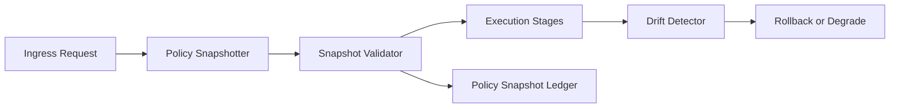

# Agent 预检策略快照选型 FAQ（Cycle 1807）

## 1) 3 分钟结论
- **发布事故常来自“执行时策略漂移”，而不是策略本身缺失。**
- **推荐：** 预检阶段冻结策略快照 + 执行期一致性校验 + 漂移阻断回退。
- **目标：** 在多服务联动场景中保证一次请求全程使用同一策略视图。

## 2) Q1 / Q2 / Q3
### Q1：为什么只读实时策略有风险？
1) 请求生命周期内策略版本可能变化；
2) 多节点读取时序不同导致判定不一致；
3) 排障时难以复盘当时策略上下文。

### Q2：可落地的快照方案？
- 请求进入时生成策略快照 ID；
- 执行阶段按快照 ID 读取冻结规则；
- 关键决策点附带快照校验签名；
- 漂移检测命中时触发阻断或降级回退。

### Q3：如何验证方案有效？
- 策略判定一致率提升；
- 漂移导致的误判率下降；
- 复盘定位时间缩短。

## 3) 架构图

## 4) 选型矩阵
| 维度 | 实时策略直读 | 预检快照（推荐） |
|---|---:|---:|
| 判定一致性 | 低 | 高 |
| 漂移可控性 | 低 | 高 |
| 复盘可解释性 | 中 | 高 |
| 实施复杂度 | 低 | 中 |
| 风险隔离能力 | 中 | 高 |

## 5) 证据与复算口径
- 证据文件：
  - `workshops/azure-agent-infra/evidence/cycle-1807-benchmark.json`
  - `workshops/azure-agent-infra/evidence/cycle-1807-latency.csv`
  - `workshops/azure-agent-infra/evidence/cycle-1807-throughput.csv`
  - `workshops/azure-agent-infra/evidence/cycle-1807-policy.csv`
- 标签：`measured / synthetic / anonymized_reported`。
- validation7：双语结构、CSP 自包含、证据轮次一致、回放链路校验通过。

## 6) 生产检查清单
- [ ] 预检快照 ID 全链路透传。
- [ ] 冻结规则读取在执行期强制启用。
- [ ] 快照签名校验失败可阻断。
- [ ] 漂移事件可审计并自动回退。
- [ ] FAQ/H5/SVG/7-card 与 evidence 轮次一致。
