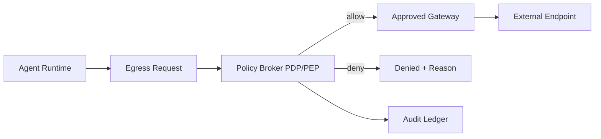

# Agent Private Egress Policy Broker Selection FAQ (Cycle 1791)

## 1) Three-minute decision
- **The real challenge is not outbound reachability itself, but controllable, auditable, replayable egress.**
- **Recommendation:** private-by-default deny + policy-broker allow path + egress audit ledger.
- **Goal:** preserve tool-chain usability within zero-trust boundaries while containing external-risk exposure.

## 2) Core questions (Q1/Q2/Q3)
### Q1: Why is direct NAT allow-listing not sustainable?
1) tenant-level policy intent is hard to encode,
2) audit trails are weakly mapped to concrete agent actions,
3) temporary exceptions become permanent drift.

### Q2: How does a broker approach land in production?
- route egress through PDP/PEP checks,
- evaluate tenant/tool/target-domain/method dimensions,
- log pre/post decision events into immutable audit records,
- cache frequent allow decisions with immediate invalidation on policy changes.

### Q3: How to measure success?
- stable intercept rate within target band,
- request-level compliance traceability,
- bounded egress-latency overhead.

## 3) Reference architecture

## 4) Decision matrix
| Dimension | Direct NAT allow | Broker policy allow (Recommended) |
|---|---:|---:|
| Least-privilege control | Low | High |
| Audit traceability | Low | High |
| Policy-change agility | Medium | High |
| Latency overhead | Low | Medium |
| Operational complexity | Low | Medium |

## 5) Evidence and reproducibility
- Evidence files:
  - `workshops/azure-agent-infra/evidence/cycle-1791-benchmark.json`
  - `workshops/azure-agent-infra/evidence/cycle-1791-latency.csv`
  - `workshops/azure-agent-infra/evidence/cycle-1791-throughput.csv`
  - `workshops/azure-agent-infra/evidence/cycle-1791-policy.csv`
- Labels: `measured / synthetic / anonymized_reported`.
- validation7 requires bilingual structure fidelity, CSP self-contained cards, and cycle-consistent evidence.

## 6) Production checklist
- [ ] Private egress default-deny is enforced.
- [ ] Broker rules support tenant/tool/target multidimensional matching.
- [ ] Allow/deny decisions are ledgered.
- [ ] Cache invalidation and rollback paths are tested.
- [ ] FAQ/H5/SVG/7-card are aligned with cycle evidence.
