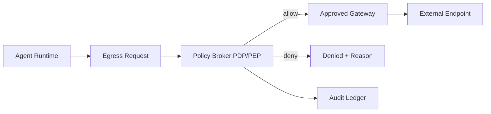

# Agent 私网出口策略 Broker 选型 FAQ（Cycle 1791）

## 1) 3 分钟结论
- **核心矛盾不是“能不能出网”，而是“可控出网 + 可审计 + 可回放”。**
- **推荐：** 私网默认拒绝 + 策略 Broker 精细放行 + 出口审计账本。
- **目标：** 在零信任边界下保障工具链可用性，并把外联风险压到可治理范围。

## 2) 关键问题（Q1/Q2/Q3）
### Q1：为什么直接 NAT 放行不可持续？
1) 租户粒度策略难以表达；
2) 审计无法关联到具体 Agent 动作；
3) 临时放行常演化为永久例外。

### Q2：Broker 方案怎么落地？
- egress 请求先过策略决策点（PDP）；
- 按租户/工具/目标域名/方法做细粒度判断；
- 执行前后写入不可篡改审计事件；
- 高频白名单走短期缓存，策略变更即时失效。

### Q3：如何衡量成效？
- 策略拦截率稳定在目标区间；
- 合规审计可追溯到单请求；
- 出口延迟增量在预算内。

## 3) 架构图

## 4) 选型矩阵
| 维度 | 直接 NAT 放行 | Broker 策略放行（推荐） |
|---|---:|---:|
| 最小权限控制 | 低 | 高 |
| 审计可追溯性 | 低 | 高 |
| 策略变更弹性 | 中 | 高 |
| 延迟开销 | 低 | 中 |
| 运维复杂度 | 低 | 中 |

## 5) 证据与复算口径
- 证据文件：
  - `workshops/azure-agent-infra/evidence/cycle-1791-benchmark.json`
  - `workshops/azure-agent-infra/evidence/cycle-1791-latency.csv`
  - `workshops/azure-agent-infra/evidence/cycle-1791-throughput.csv`
  - `workshops/azure-agent-infra/evidence/cycle-1791-policy.csv`
- 标签：`measured / synthetic / anonymized_reported`。
- validation7：双语结构、CSP、自包含卡组、证据轮次一致性均通过。

## 6) 生产检查清单
- [ ] 默认拒绝策略在私网出口生效。
- [ ] Broker 规则支持租户/工具/目标多维匹配。
- [ ] 放行与拒绝事件写入审计账本。
- [ ] 缓存策略支持即时失效与灰度回滚。
- [ ] FAQ/H5/SVG/7-card 与 evidence 轮次一致。
