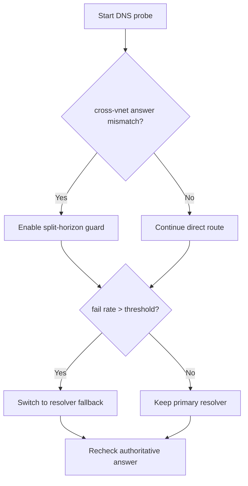
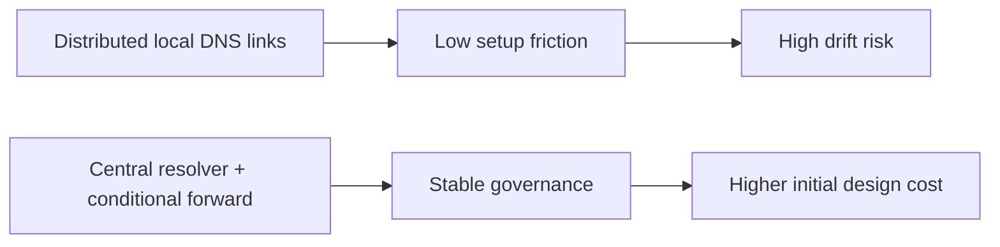
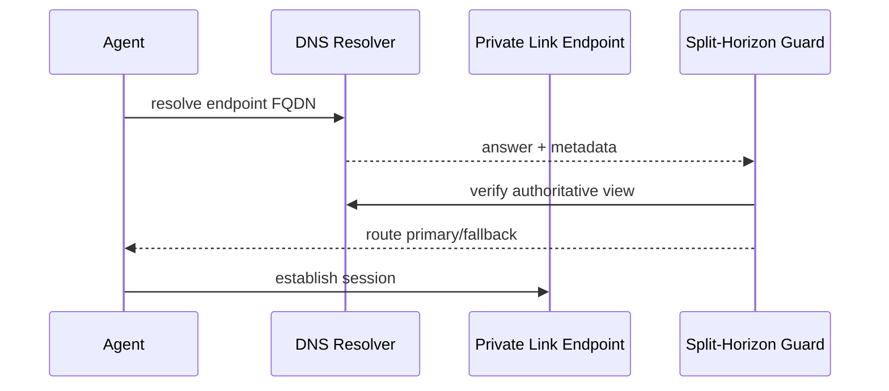

# Agent Private Link DNS Split-Horizon Guard Selection FAQ (Azure AI Agent Infra)

## 1) 3-minute conclusions
- **For Azure OpenAI/Foundry Private Link across VNets, DNS split-horizon inconsistency is the top outage driver.**
- **Use a centralized Private DNS Resolver with conditional forwarding to prevent multi-region zone-link drift.**
- **Acceptance targets: `dns_fail_rate <0.2%`, `fallback_latency_p95 <80ms`, `stale_record_window <60s`.**

## 2) Q1 / Q2 / Q3
- **Why does the same FQDN resolve differently per subnet?** Recursive path and forwarder policies diverge.
- **Why split-horizon guard?** It detects wrong views early and blocks bad routes.
- **Minimum viable loop?** Dual-view probes, authoritative validation, and auto rollback.

### Q1: When to trigger protection?
When cross-region mismatch exceeds threshold and connection failures cluster.

### Q2: When to allow direct route?
When authoritative records stay consistent and probes continuously pass.

### Q3: How to quantify gain?
Compare outage recovery time versus added DNS processing overhead.

## 3) Mermaid diagrams
### 3.1 Decision tree

### 3.2 Path comparison

### 3.3 Sequence

## 4) Decision matrix
| Dimension | Distributed local DNS links | Central resolver + guard (Recommended) |
|---|---:|---:|
| Consistency | Medium-low | High |
| Recovery speed | Medium | High |
| Ops complexity (1-10) | 5 | 7 |
| Compliance auditability | Medium | High |
| Cross-region scalability | Medium | High |

## 5) Quant model + 7-card insights
- Drift rate: `DriftRate = MismatchQueries / TotalQueries`
- Recovery gain: `RecoveryGain = BaselineMTTR - GuardMTTR`
- Example (`synthetic_assumed`):
  - `MismatchQueries=46, TotalQueries=12,000`
  - `DriftRate=0.38%`
  - `BaselineMTTR=17m, GuardMTTR=6m`
  - `RecoveryGain=11m`
- Evidence:
  - `workshops/azure-agent-infra/evidence/cycle-1469-benchmark.json`
  - `workshops/azure-agent-infra/evidence/cycle-1469-sources.json`
- Labels: `official/synthetic_assumed/not_measured`.

## 6) Production verification checklist
- [ ] Private DNS Resolver + forwarding rules are versioned
- [ ] Dual-view probe and authoritative checks are alerting
- [ ] Fallback and rollback thresholds are auditable
- [ ] Region-scale validation jobs are wired in
- [ ] FAQ/7-card source labels are complete
