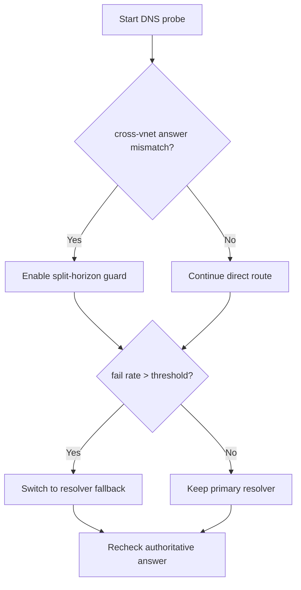
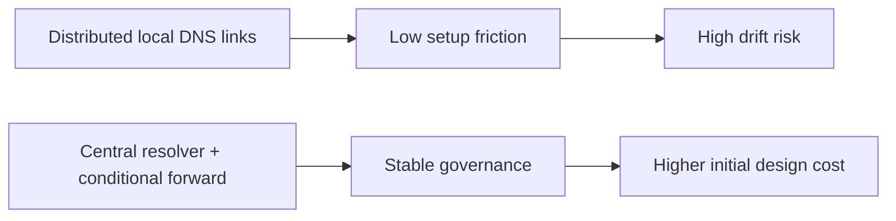
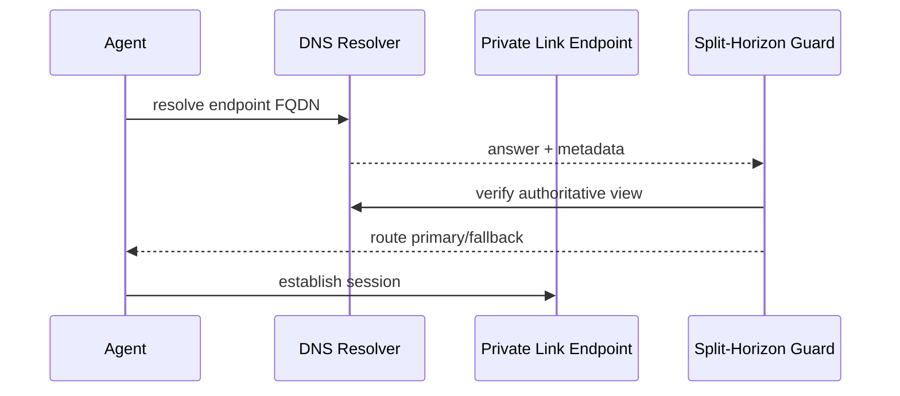

# Agent Private Link DNS Split-Horizon Guard 选型 FAQ（Azure AI Agent Infra）

## 1) 3 分钟结论
- **跨 VNet 访问 Azure OpenAI/Foundry Private Link 时，DNS split-horizon 不一致是首要故障源。**
- **生产建议使用集中式 Private DNS Resolver + 条件转发，避免多区域手工 zone 链接漂移。**
- **验收阈值：`dns_fail_rate <0.2%`、`fallback_latency_p95 <80ms`、`stale_record_window <60s`。**

## 2) Q1 / Q2 / Q3
- **为何同一 FQDN 在不同子网结果不同？**：递归链路和转发策略不一致。
- **为何需要 split-horizon guard？**：提前识别错误视图并阻断错误路由。
- **最小闭环？**：双视图探测、权威校验、自动回切。

### Q1：何时触发保护？
当跨区解析偏差率超过阈值并出现连接失败聚集。

### Q2：何时允许直连？
当权威记录一致且探测连续通过。

### Q3：如何量化收益？
比较故障收敛时间与额外解析开销。

## 3) Mermaid 图
### 3.1 决策树

### 3.2 路径对比

### 3.3 时序

## 4) 决策矩阵
| 维度 | 分散本地 DNS 链接 | 集中 Resolver + Guard（推荐） |
|---|---:|---:|
| 一致性 | 中低 | 高 |
| 故障收敛 | 中 | 高 |
| 运维复杂度（1-10） | 5 | 7 |
| 合规可审计性 | 中 | 高 |
| 跨区扩展性 | 中 | 高 |

## 5) 定量算例与 7-Card 洞察
- 解析偏差率：`DriftRate = MismatchQueries / TotalQueries`
- 收敛收益：`RecoveryGain = BaselineMTTR - GuardMTTR`
- 示例（`synthetic_assumed`）：
  - `MismatchQueries=46, TotalQueries=12,000`
  - `DriftRate=0.38%`
  - `BaselineMTTR=17m, GuardMTTR=6m`
  - `RecoveryGain=11m`
- 证据：
  - `workshops/azure-agent-infra/evidence/cycle-1469-benchmark.json`
  - `workshops/azure-agent-infra/evidence/cycle-1469-sources.json`
- 标签：`official/synthetic_assumed/not_measured`。

## 6) 生产核验 Checklist
- [ ] Private DNS Resolver + 转发规则已版本化
- [ ] 双视图探测与权威校验告警已启用
- [ ] fallback 路由与回切阈值可审计
- [ ] 区域扩容后自动校验任务已接入
- [ ] FAQ/7-Card 来源标签完整
