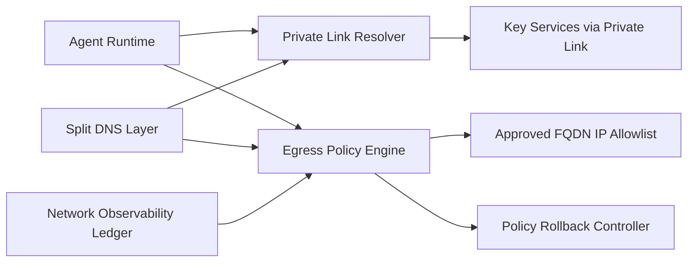

# Private Link Egress Control Selection FAQ (Cycle 1841)

## 1) Three-minute decision
- **Core tradeoff:** open internet egress accelerates integration but increases data-exfiltration risk; full lock-down can break dependency refresh and service calls.
- **Recommendation:** Private Link first, strict egress allowlist, split DNS resolution, and controlled change windows.
- **Goal:** preserve required connectivity under zero-trust boundaries while minimizing outbound data exposure.

## 2) Q1 / Q2 / Q3
### Q1: Why is default open internet egress unsustainable?
1) it cannot prove sensitive traffic stays on controlled paths,
2) sudden third-party dependency changes widen supply-chain risk,
3) audits cannot provide reproducible network-boundary evidence.

### Q2: What is a production-grade Private Link egress model?
- **Path priority:** critical dependencies route via Private Link or service endpoints,
- **Egress allowlist:** permit only required FQDN/IP by environment,
- **DNS strategy:** split internal/external resolution to prevent bypass,
- **Policy rollback:** revert to last stable network policy on abnormal deny spikes.

### Q3: How do we validate secure availability?
- target Private Link hit-rate for critical traffic,
- higher unauthorized egress block rate with controlled false blocks,
- measurable rollback and service-recovery times.

## 3) Reference architecture

## 4) Decision matrix
| Dimension | Open internet egress | Private Link + allowlist control (Recommended) |
|---|---:|---:|
| Security boundary | Low | High |
| Availability | Medium-high | Medium-high |
| Audit traceability | Low | High |
| Change complexity | Low | Medium |
| Compliance readiness | Low | High |

## 5) Evidence and reproducibility
- Evidence files:
  - `workshops/azure-agent-infra/evidence/cycle-1841-benchmark.json`
  - `workshops/azure-agent-infra/evidence/cycle-1841-latency.csv`
  - `workshops/azure-agent-infra/evidence/cycle-1841-throughput.csv`
  - `workshops/azure-agent-infra/evidence/cycle-1841-policy.csv`
- Labels: `measured / synthetic / anonymized_reported`.
- validation7 enforces bilingual six-part structure, CSP self-contained 7-card output, strict cycle-evidence alignment, and replayability.

## 6) Production checklist
- [ ] Private Link routes are active for critical dependencies.
- [ ] Environment-tiered egress allowlists are auditable and replayable.
- [ ] Split DNS policy blocks bypass paths.
- [ ] Network-policy rollback drills pass.
- [ ] FAQ/H5/SVG/7-card align with cycle evidence.
