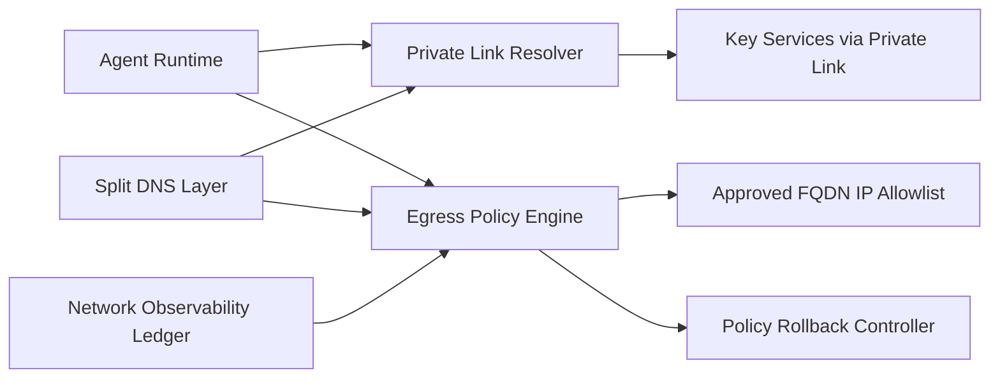

# Private Link 出站控制选型 FAQ（Cycle 1841）

## 1) 3 分钟结论
- **核心矛盾：** Agent 运行面若开放公网出站，集成速度快但数据外泄风险增大；全部封死又会导致依赖更新与调用失败。
- **推荐：** Private Link 优先 + 出站 allowlist + DNS 分层解析 + 变更冻结窗口。
- **目标：** 在零信任边界下保留必要外联能力，并把数据外流面控制到最小。

## 2) Q1 / Q2 / Q3
### Q1：为什么“默认全开公网出站”不可持续？
1) 无法精确证明敏感流量只走受控路径；
2) 第三方依赖突发变更会放大供应链攻击面；
3) 审计报告难以给出可复核的网络边界证据。

### Q2：生产级 Private Link 出站控制方案是什么？
- **链路优先级：** 关键依赖全部走 Private Link / Service Endpoint；
- **出站白名单：** 仅允许必要 FQDN/IP，并按环境分层；
- **DNS 策略：** 内外域名分流解析，防止旁路访问；
- **策略回退：** 变更导致拒绝率异常时回滚到上一个稳定网络策略。

### Q3：如何验证“安全且可用”？
- 关键流量 Private Link 命中率达到目标；
- 非授权出站拦截率提升且误拦截可控；
- 网络策略回滚时间与业务恢复时间可量化。

## 3) 架构图

## 4) 选型矩阵
| 维度 | 公网全开放出站 | Private Link + 白名单控制（推荐） |
|---|---:|---:|
| 安全边界 | 低 | 高 |
| 可用性 | 中高 | 中高 |
| 审计可追溯 | 低 | 高 |
| 变更复杂度 | 低 | 中 |
| 合规适配 | 低 | 高 |

## 5) 证据与复算口径
- 证据文件：
  - `workshops/azure-agent-infra/evidence/cycle-1841-benchmark.json`
  - `workshops/azure-agent-infra/evidence/cycle-1841-latency.csv`
  - `workshops/azure-agent-infra/evidence/cycle-1841-throughput.csv`
  - `workshops/azure-agent-infra/evidence/cycle-1841-policy.csv`
- 标签：`measured / synthetic / anonymized_reported`。
- validation7：双语六段结构、7-card CSP 自包含、轮次与 evidence 一致、可回放链路通过。

## 6) 生产检查清单
- [ ] 关键依赖 Private Link 路由生效。
- [ ] 出站白名单按环境分层并审计可回放。
- [ ] DNS 分流策略阻断旁路路径。
- [ ] 网络策略回滚演练通过。
- [ ] FAQ/H5/SVG/7-card 与 evidence 轮次一致。
