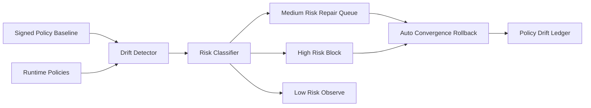

# Agent Provenance Policy Drift Control Selection FAQ (Cycle 1829)

## 1) Three-minute decision
- **Core tension:** after policy release, temporary exceptions and environment skew gradually introduce drift.
- **Recommendation:** signed policy baselines plus drift detection plus automatic convergence rollback.
- **Goal:** keep policy drift windows short without slowing safe delivery.

## 2) Q1 / Q2 / Q3
### Q1: Why is policy drift harder to detect in agent infra?
1) MCP tools, A2A routes, and gateway rules span multiple control planes,
2) emergency allowlists often remain after incidents,
3) multi-region multi-tenant rollout cadence is inconsistent.

### Q2: What production-ready drift-control strategy should be used?
- **Baseline hardening:** signed policy bundles as single source of truth,
- **Continuous diffing:** minute-level runtime vs baseline comparison,
- **Risk tiers:** auto-block high-risk drift and queue timed repair for medium or low drift,
- **Auto convergence:** rollback to last verified policy if drift is not fixed in time.

### Q3: How do we validate effectiveness without slower releases?
- shorter detection-to-remediation time,
- bounded lifetime of high-risk drift,
- stable success rate of normal policy releases.

## 3) Reference architecture

## 4) Decision matrix
| Dimension | Manual inspection control | Baseline drift auto-control (Recommended) |
|---|---:|---:|
| Drift detection timeliness | Low | High |
| High-risk blocking strength | Medium | High |
| Change stability | Medium | High |
| Implementation complexity | Low | Medium |
| Long-term governance cost | High | Medium |

## 5) Evidence and reproducibility
- Evidence files:
  - `workshops/azure-agent-infra/evidence/cycle-1829-benchmark.json`
  - `workshops/azure-agent-infra/evidence/cycle-1829-latency.csv`
  - `workshops/azure-agent-infra/evidence/cycle-1829-throughput.csv`
  - `workshops/azure-agent-infra/evidence/cycle-1829-policy.csv`
- Labels: `measured / synthetic / anonymized_reported`.
- validation7 enforces bilingual six-part structure, CSP self-contained 7-card output, strict cycle-evidence alignment, and replayability.

## 6) Production checklist
- [ ] Signed baseline and policy version governance are live.
- [ ] Runtime drift detection cadence and thresholds are configured.
- [ ] High-risk auto-block and rollback paths are integrated.
- [ ] Drift ledger and alert flows are traceable.
- [ ] FAQ/H5/SVG/7-card align with cycle evidence.
