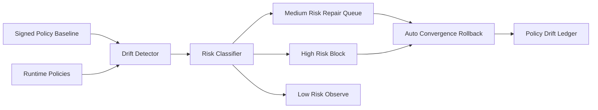

# Agent 来源策略漂移控制选型 FAQ（Cycle 1829）

## 1) 3 分钟结论
- **核心矛盾：** 治理策略上线后会因临时放行、手工热修和多环境差异逐步漂移。
- **推荐：** 策略基线签名 + 漂移检测器 + 自动收敛回滚。
- **目标：** 在不牺牲变更效率的前提下，持续压缩策略偏差窗口。

## 2) Q1 / Q2 / Q3
### Q1：为什么策略漂移在 Agent 基础设施中更隐蔽？
1) MCP 工具、A2A 路由、网关规则跨多个控制面；
2) 临时白名单常在故障后遗留；
3) 多区域和多租户的配置节奏不同步。

### Q2：可落地的漂移控制策略是什么？
- **基线固化**：以签名策略包定义唯一可信基线；
- **持续比对**：按分钟级比对运行态与基线差异；
- **风险分级**：高风险漂移自动阻断，中低风险进入限时修复队列；
- **自动收敛**：超时未修复自动回滚到上一个通过验证的策略版本。

### Q3：如何验证“控制有效且不拖慢发布”？
- 漂移检测到修复时长下降；
- 高风险策略偏差存活时间受控；
- 正常策略发布成功率维持稳定。

## 3) 架构图

## 4) 选型矩阵
| 维度 | 人工巡检控制 | 基线漂移自动控制（推荐） |
|---|---:|---:|
| 漂移发现时效 | 低 | 高 |
| 高风险阻断能力 | 中 | 高 |
| 变更稳定性 | 中 | 高 |
| 实施复杂度 | 低 | 中 |
| 长期治理成本 | 高 | 中 |

## 5) 证据与复算口径
- 证据文件：
  - `workshops/azure-agent-infra/evidence/cycle-1829-benchmark.json`
  - `workshops/azure-agent-infra/evidence/cycle-1829-latency.csv`
  - `workshops/azure-agent-infra/evidence/cycle-1829-throughput.csv`
  - `workshops/azure-agent-infra/evidence/cycle-1829-policy.csv`
- 标签：`measured / synthetic / anonymized_reported`。
- validation7：双语六段结构、7-card CSP 自包含、轮次与 evidence 一致、可回放链路通过。

## 6) 生产检查清单
- [ ] 策略基线签名与版本治理已上线。
- [ ] 运行态漂移检测频率与阈值已配置。
- [ ] 高风险自动阻断与回滚链路已联调。
- [ ] 漂移账本和告警流程可追溯。
- [ ] FAQ/H5/SVG/7-card 与 evidence 轮次一致。
