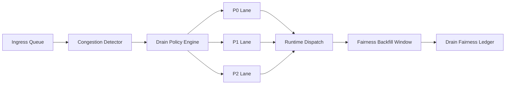

# Agent Queue Drain Fairness SLO Selection FAQ (Cycle 1826)

## 1) Three-minute decision
- **Core tension:** congestion requires fast queue draining, but blunt dropping causes long-tail tenant starvation.
- **Recommendation:** lane-aware drain policy + fairness budgets + SLO-constrained backfill.
- **Goal:** restore critical-path latency while preventing persistent unfairness.

## 2) Q1 / Q2 / Q3
### Q1: Why does FIFO-style draining fail under stress?
1) hot-tenant retries amplify queue pressure,
2) critical and batch workloads are treated equally,
3) no backfill path creates long-lived service bias.

### Q2: What production-ready fairness drain strategy should be used?
- **Lane-based draining:** separate weights for P0, P1, P2,
- **Fairness budgets:** bounded drop and delay quotas per tenant,
- **Backfill window:** post-congestion recovery share for suppressed tenants,
- **Observability:** starvation duration, retry amplification, backfill completion.

### Q3: How do we validate stability and fairness together?
- critical-path P95 recovery meets targets,
- long-tail starvation duration stays bounded,
- backfill completion rate hits budget goals.

## 3) Reference architecture

## 4) Decision matrix
| Dimension | Unified draining | Fairness-constrained draining (Recommended) |
|---|---:|---:|
| Congestion recovery speed | Medium | High |
| Long-tail fairness | Low | High |
| Retry storm suppression | Medium | High |
| Implementation complexity | Low | Medium |
| Operational explainability | Medium | High |

## 5) Evidence and reproducibility
- Evidence files:
  - `workshops/azure-agent-infra/evidence/cycle-1826-benchmark.json`
  - `workshops/azure-agent-infra/evidence/cycle-1826-latency.csv`
  - `workshops/azure-agent-infra/evidence/cycle-1826-throughput.csv`
  - `workshops/azure-agent-infra/evidence/cycle-1826-policy.csv`
- Labels: `measured / synthetic / anonymized_reported`.
- validation7 enforces bilingual six-part structure, CSP self-contained 7-card output, strict cycle-evidence alignment, and replayability.

## 6) Production checklist
- [ ] Lane drain weights and thresholds are deployed.
- [ ] Tenant fairness budgets and alerts are configured.
- [ ] Backfill windows and recovery pacing are integrated.
- [ ] Starvation duration, backfill rate, and retry amplification are observable.
- [ ] FAQ/H5/SVG/7-card align with cycle evidence.
