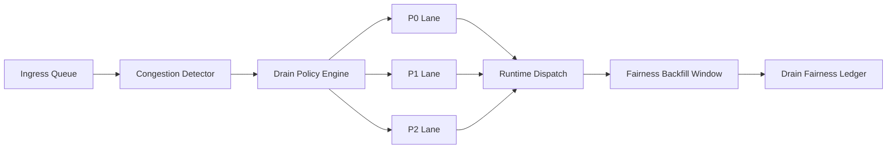

# Agent 队列清退公平性 SLO 选型 FAQ（Cycle 1826）

## 1) 3 分钟结论
- **核心矛盾：** 拥塞时必须快速清退队列，但粗暴丢弃会让低优先级租户长期饥饿并触发投诉。
- **推荐：** 分带清退策略 + 公平性预算 + SLO 约束回补。
- **目标：** 在保障关键链路时延的同时，避免长期不公平与系统抖动。

## 2) Q1 / Q2 / Q3
### Q1：为什么“按到达顺序清空”会失败？
1) 热租户重试放大排队，挤压长尾租户；
2) 关键请求和批处理请求被同等对待；
3) 没有回补机制会形成永久性服务偏差。

### Q2：可落地的队列清退公平策略是什么？
- **分带清退**：P0/P1/P2 使用不同清退权重；
- **公平预算**：每租户设定可接受丢弃与延迟预算；
- **回补窗口**：拥塞恢复后为被压制租户提供回补执行份额；
- **观测告警**：跟踪饥饿时间、重试放大率、回补完成率。

### Q3：如何验证“稳态与公平并存”？
- 关键路径 P95 恢复时间达标；
- 长尾租户饥饿时长受控；
- 回补执行完成率达到预算目标。

## 3) 架构图

## 4) 选型矩阵
| 维度 | 统一清退 | 公平性约束清退（推荐） |
|---|---:|---:|
| 拥塞恢复速度 | 中 | 高 |
| 长尾租户公平性 | 低 | 高 |
| 重试风暴抑制 | 中 | 高 |
| 实施复杂度 | 低 | 中 |
| 运维可解释性 | 中 | 高 |

## 5) 证据与复算口径
- 证据文件：
  - `workshops/azure-agent-infra/evidence/cycle-1826-benchmark.json`
  - `workshops/azure-agent-infra/evidence/cycle-1826-latency.csv`
  - `workshops/azure-agent-infra/evidence/cycle-1826-throughput.csv`
  - `workshops/azure-agent-infra/evidence/cycle-1826-policy.csv`
- 标签：`measured / synthetic / anonymized_reported`。
- validation7：双语六段结构、7-card CSP 自包含、轮次与 evidence 一致、可回放链路通过。

## 6) 生产检查清单
- [ ] 清退分带权重与阈值已上线。
- [ ] 租户公平预算与告警规则已配置。
- [ ] 回补窗口策略与恢复节奏已联调。
- [ ] 饥饿时长、回补率与重试放大量可观测。
- [ ] FAQ/H5/SVG/7-card 与 evidence 轮次一致。
