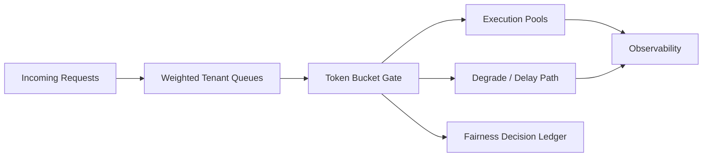

# Agent Queue Fairness and Token Bucket Selection FAQ (Cycle 1787)

## 1) Three-minute decision
- **In multi-tenant agent queues, fairness drift is usually the primary failure mode, not average throughput.**
- **Recommendation:** weighted tenant queues + token-bucket quotas + over-quota degrade paths.
- **Goal:** protect critical tenant SLAs while preventing bursty tenants from starving shared capacity.

## 2) Core questions (Q1/Q2/Q3)
### Q1: Why does global FIFO often fail?
1) burst-heavy tenants monopolize queue head time,
2) latency-sensitive tenants lose priority guarantees,
3) average throughput can hide severe tail-latency regression.

### Q2: What is the minimum viable fairness control?
- queue layer: tenant/priority buckets,
- quota layer: token bucket for burst and sustained rate,
- degrade layer: delayed queue or lower-priority model for over-quota traffic.

### Q3: How to validate effectiveness?
- P95 latency spread across tenants narrows,
- high-frequency tenants no longer suppress low-frequency tenants,
- over-quota actions are auditable and replayable.

## 3) Reference architecture

## 4) Decision matrix
| Dimension | Global FIFO | Weighted queues + token bucket (Recommended) |
|---|---:|---:|
| Multi-tenant fairness | Low | High |
| Peak controllability | Low | High |
| Tail-latency stability | Low | High |
| Implementation complexity | Low | Medium |
| Policy explainability | Medium | High |

## 5) Evidence and reproducibility
- Evidence files:
  - `workshops/azure-agent-infra/evidence/cycle-1787-benchmark.json`
  - `workshops/azure-agent-infra/evidence/cycle-1787-latency.csv`
  - `workshops/azure-agent-infra/evidence/cycle-1787-throughput.csv`
  - `workshops/azure-agent-infra/evidence/cycle-1787-policy.csv`
- Labels: `measured / synthetic / anonymized_reported`.
- validation7 requires bilingual structure, CSP self-contained cards, evidence consistency, and replayability trace.

## 6) Production checklist
- [ ] Tenant weights and priorities are explicit and tunable.
- [ ] Token bucket parameters support tenant canary rollout.
- [ ] Over-quota degrade path has rollback thresholds.
- [ ] Fairness decisions and hits are ledgered.
- [ ] FAQ/H5/SVG/7-card references are cycle-aligned.
