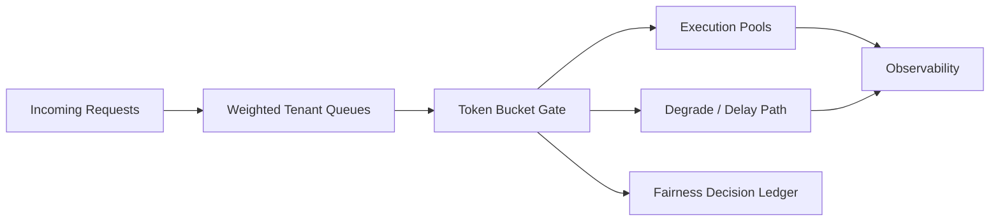

# Agent 队列公平性与 Token Bucket 选型 FAQ（Cycle 1787）

## 1) 3 分钟结论
- **多租户 Agent 队列的核心问题是公平性失衡，不是平均吞吐不足。**
- **推荐：** 租户权重队列 + Token Bucket 配额 + 超配额降级路径三段控制。
- **目标：** 保障关键租户 SLA，同时避免单租户突发流量挤占共享资源。

## 2) 关键问题（Q1/Q2/Q3）
### Q1：为什么全局 FIFO 容易导致争抢失控？
1) 瞬时大流量租户会长期占据队头；
2) 低延迟租户缺少优先保障；
3) 平均吞吐看似正常但尾延迟恶化。

### Q2：公平性控制最小可落地方案是什么？
- 队列层：按租户权重或业务级别拆桶；
- 配额层：Token Bucket 限制突发与平均速率；
- 降级层：超配额请求进入延迟队列或低优先模型。

### Q3：如何验证公平性策略生效？
- 各租户 P95 时延差距收敛；
- 高频租户不再长期压制低频租户；
- 超配额处置可审计可回放。

## 3) 架构图

## 4) 选型矩阵
| 维度 | 全局 FIFO | 权重队列+Token Bucket（推荐） |
|---|---:|---:|
| 多租户公平性 | 低 | 高 |
| 峰值可控性 | 低 | 高 |
| 尾延迟稳定性 | 低 | 高 |
| 实施复杂度 | 低 | 中 |
| 策略可解释性 | 中 | 高 |

## 5) 证据与复算口径
- 证据文件：
  - `workshops/azure-agent-infra/evidence/cycle-1787-benchmark.json`
  - `workshops/azure-agent-infra/evidence/cycle-1787-latency.csv`
  - `workshops/azure-agent-infra/evidence/cycle-1787-throughput.csv`
  - `workshops/azure-agent-infra/evidence/cycle-1787-policy.csv`
- 标签：`measured / synthetic / anonymized_reported`。
- validation7：双语结构、CSP、证据一致、可回放链路全部通过。

## 6) 生产检查清单
- [ ] 租户权重与优先级策略明确且可调。
- [ ] Token Bucket 参数支持按租户灰度。
- [ ] 超配额降级路径有明确回滚阈值。
- [ ] 公平性决策与命中记录进入审计账本。
- [ ] FAQ/H5/SVG/7-card 与 evidence 轮次一致。
