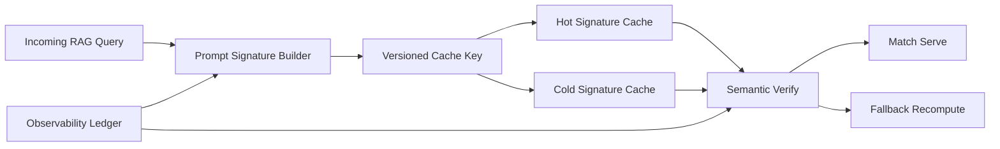

# RAG Prompt Signature Cache Selection FAQ (Cycle 1859)

## 1) Three-minute decision
- **Core tradeoff:** prompt-template reuse improves cost and latency, but coarse signatures cause false hits while overly fine signatures reduce hit rate.
- **Recommendation:** layered signatures (template/retrieval-policy), versioned cache keys, and mismatch fallback.
- **Goal:** improve cache-hit quality and reduce token spend without answer-consistency regression.

## 2) Q1 / Q2 / Q3
### Q1: Why is prompt-text hashing alone insufficient?
1) identical prompt text with different retrieval context can yield different semantics,
2) tenant policy differences can alter allowed citation scope,
3) template-version changes make old cache keys semantically stale.

### Q2: What production-grade prompt-signature cache strategy should be used?
- **Layered signature:** template hash plus retrieval-parameter digest plus tenant-policy version,
- **Versioned key:** signature schema version inside key for smooth migration,
- **Mismatch fallback:** lightweight semantic check on hit, then recompute on mismatch,
- **Hot/cold tiers:** hot cache for frequent signatures, short TTL cold cache for long tail.

### Q3: How do we validate strategy quality?
- higher correct-hit ratio and lower false-hit ratio,
- lower P95 latency and token cost,
- controlled regression risk during version upgrades.

## 3) Reference architecture

## 4) Decision matrix
| Dimension | Text-hash-only cache | Layered signature cache (Recommended) |
|---|---:|---:|
| Hit correctness | Low | High |
| Hit rate | Medium | High |
| Upgrade controllability | Low | High |
| Implementation complexity | Low | Medium |
| Cost benefit | Medium | High |

## 5) Evidence and reproducibility
- Evidence files:
  - `workshops/azure-agent-infra/evidence/cycle-1859-benchmark.json`
  - `workshops/azure-agent-infra/evidence/cycle-1859-latency.csv`
  - `workshops/azure-agent-infra/evidence/cycle-1859-throughput.csv`
  - `workshops/azure-agent-infra/evidence/cycle-1859-policy.csv`
- Labels: `measured / synthetic / anonymized_reported`.
- validation7 enforces bilingual six-part structure, CSP self-contained 7-card output, strict cycle-evidence alignment, and replayability.

## 6) Production checklist
- [ ] Layered-signature fields and version policy are frozen.
- [ ] Semantic light-check and mismatch fallback path is integrated.
- [ ] Hot/cold cache tiering and TTL policy are active.
- [ ] Upgrade compatibility and rollback drills pass.
- [ ] FAQ/H5/SVG/7-card align with cycle evidence.
