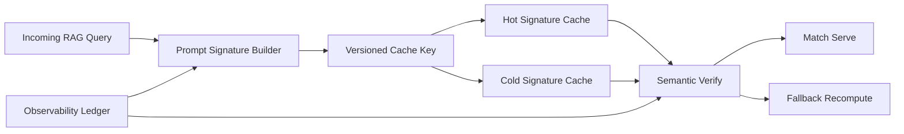

# RAG Prompt Signature 缓存选型 FAQ（Cycle 1859）

## 1) 3 分钟结论
- **核心矛盾：** RAG 请求模板复用能降本提速，但签名粒度过粗会导致错误命中，过细又会牺牲命中率。
- **推荐：** 分层签名（模板/检索参数/租户策略）+ 版本化缓存键 + 失配回退。
- **目标：** 在保持答案一致性的同时提高缓存命中质量并降低 token 消耗。

## 2) Q1 / Q2 / Q3
### Q1：为什么“只按 prompt 文本哈希”不够？
1) 同文案不同检索上下文会产生不同语义结果；
2) 租户策略差异可能改变允许引用范围；
3) 模板版本升级后旧缓存会造成隐性偏差。

### Q2：生产级 prompt signature 缓存策略如何设计？
- **分层签名：** 模板哈希 + 检索参数摘要 + 租户策略版本；
- **版本化键：** 签名键包含 schema 版本，支持平滑升级；
- **失配回退：** 命中后再做轻量语义校验，不通过即回源重算；
- **冷热分层：** 高频签名热缓存，低频签名短 TTL 冷缓存。

### Q3：如何验证缓存策略有效？
- 正确命中率提升且误命中率下降；
- 请求 P95 与 token 成本下降；
- 版本升级期间回归风险可控。

## 3) 架构图

## 4) 选型矩阵
| 维度 | 纯文本哈希缓存 | 分层签名缓存（推荐） |
|---|---:|---:|
| 命中正确性 | 低 | 高 |
| 命中率 | 中 | 高 |
| 升级可控性 | 低 | 高 |
| 实施复杂度 | 低 | 中 |
| 成本收益 | 中 | 高 |

## 5) 证据与复算口径
- 证据文件：
  - `workshops/azure-agent-infra/evidence/cycle-1859-benchmark.json`
  - `workshops/azure-agent-infra/evidence/cycle-1859-latency.csv`
  - `workshops/azure-agent-infra/evidence/cycle-1859-throughput.csv`
  - `workshops/azure-agent-infra/evidence/cycle-1859-policy.csv`
- 标签：`measured / synthetic / anonymized_reported`。
- validation7：双语六段结构、7-card CSP 自包含、轮次与 evidence 一致、可回放链路通过。

## 6) 生产检查清单
- [ ] 分层签名字段与版本策略已冻结。
- [ ] 语义轻校验与失配回退链路打通。
- [ ] 热冷缓存分层与 TTL 策略生效。
- [ ] 升级兼容与回滚流程可演练。
- [ ] FAQ/H5/SVG/7-card 与 evidence 轮次一致。
