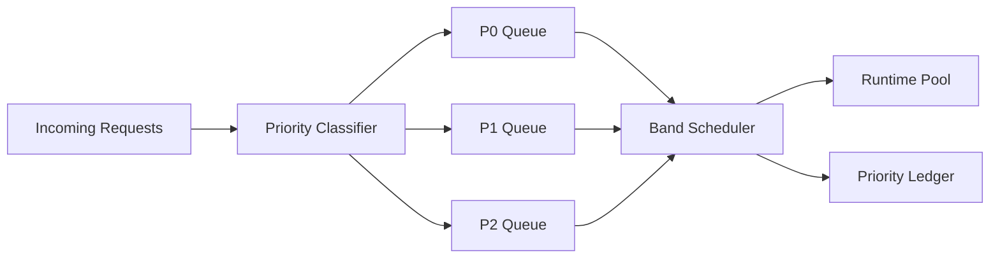

# Agent Request Priority Banding Selection FAQ (Cycle 1820)

## 1) Three-minute decision
- **Core tension:** equal-priority scheduling under congestion amplifies latency on critical paths, causing high-value and low-value flows to fail together.
- **Recommendation:** P0/P1/P2 banded scheduling + guaranteed quotas + coordinated degradation.
- **Goal:** protect critical success rates under peak congestion while keeping total throughput predictable.

## 2) Q1 / Q2 / Q3
### Q1: Why is FIFO insufficient in production agent platforms?
1) high-value requests are drowned by low-priority spikes,
2) retry storms further compress queue headroom,
3) no banding means no explainable resource policy.

### Q2: What banded-priority strategy is production-ready?
- **P0:** transaction/security/compliance critical paths with guaranteed quota,
- **P1:** core experience flows with elastic quota,
- **P2:** deferrable workloads executed off-peak or in batch,
- **Coordination rule:** under congestion, throttle P2 first to protect P0/P1.

### Q3: How do we validate effectiveness?
- P0 success rate and P95 stay within SLO in peak windows,
- global throughput degradation remains bounded,
- low-priority work is delayed but not permanently starved.

## 3) Reference architecture

## 4) Decision matrix
| Dimension | Unified queue scheduling | Banded priority scheduling (Recommended) |
|---|---:|---:|
| Critical-path availability | Low | High |
| Peak congestion resilience | Medium | High |
| Fairness explainability | Low | High |
| Implementation complexity | Low | Medium |
| Operational tuning space | Low | High |

## 5) Evidence and reproducibility
- Evidence files:
  - `workshops/azure-agent-infra/evidence/cycle-1820-benchmark.json`
  - `workshops/azure-agent-infra/evidence/cycle-1820-latency.csv`
  - `workshops/azure-agent-infra/evidence/cycle-1820-throughput.csv`
  - `workshops/azure-agent-infra/evidence/cycle-1820-policy.csv`
- Labels: `measured / synthetic / anonymized_reported`.
- validation7 enforces bilingual six-part structure, CSP self-contained 7-card output, strict cycle-evidence alignment, and replayability.

## 6) Production checklist
- [ ] P0/P1/P2 classification policy is released and versioned.
- [ ] Banded guaranteed quotas and congestion thresholds are integrated.
- [ ] Peak-window P0 SLO and P2 latency bounds are load-tested.
- [ ] Priority ledger is traceable and alertable.
- [ ] FAQ/H5/SVG/7-card align with cycle evidence.
