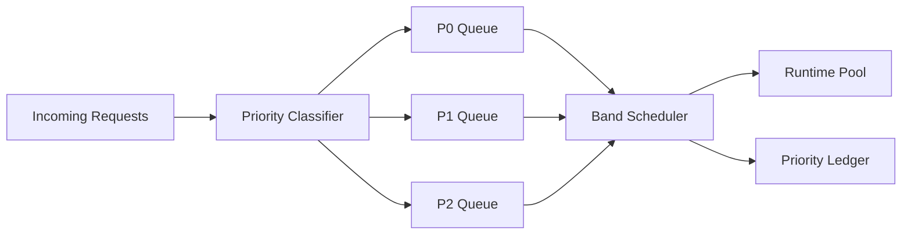

# Agent 请求优先级分带选型 FAQ（Cycle 1820）

## 1) 3 分钟结论
- **核心矛盾：** 全部请求同权调度会在拥塞时放大关键链路延迟，导致高价值场景和低价值场景一起失稳。
- **推荐：** P0/P1/P2 分带调度 + 配额保底 + 退化策略联动。
- **目标：** 在峰值拥塞下优先保障关键请求成功率，同时保持整体吞吐可预测。

## 2) Q1 / Q2 / Q3
### Q1：为什么“先到先服务”在 Agent 生产环境不够？
1) 高价值请求会被低优先级洪峰淹没；
2) 重试风暴进一步挤压队列；
3) 无分带时无法解释资源倾斜策略。

### Q2：可落地的优先级分带策略是什么？
- **P0**：交易/安全/合规关键路径，保底配额与最短排队目标；
- **P1**：核心体验链路，动态弹性配额；
- **P2**：可延迟任务，低峰执行或批处理；
- **联动规则**：拥塞阈值触发时，先收紧 P2，再保护 P0/P1。

### Q3：如何验证分带策略有效？
- P0 成功率和 P95 延迟在峰值窗口仍满足 SLO；
- 全局吞吐降幅可控；
- 低优先级任务延后但不长期饥饿。

## 3) 架构图

## 4) 选型矩阵
| 维度 | 统一队列调度 | 分带优先级调度（推荐） |
|---|---:|---:|
| 关键链路可用性 | 低 | 高 |
| 峰值拥塞韧性 | 中 | 高 |
| 公平性可解释 | 低 | 高 |
| 实施复杂度 | 低 | 中 |
| 运营调优空间 | 低 | 高 |

## 5) 证据与复算口径
- 证据文件：
  - `workshops/azure-agent-infra/evidence/cycle-1820-benchmark.json`
  - `workshops/azure-agent-infra/evidence/cycle-1820-latency.csv`
  - `workshops/azure-agent-infra/evidence/cycle-1820-throughput.csv`
  - `workshops/azure-agent-infra/evidence/cycle-1820-policy.csv`
- 标签：`measured / synthetic / anonymized_reported`。
- validation7：双语六段结构、7-card CSP 自包含、轮次与 evidence 严格一致、链路可回放通过。

## 6) 生产检查清单
- [ ] P0/P1/P2 分类规则已落地并版本化。
- [ ] 分带保底配额与拥塞阈值已联调。
- [ ] 峰值下 P0 SLO 与 P2 延迟上限已压测。
- [ ] 优先级账本可追溯与告警。
- [ ] FAQ/H5/SVG/7-card 与 evidence 轮次一致。
