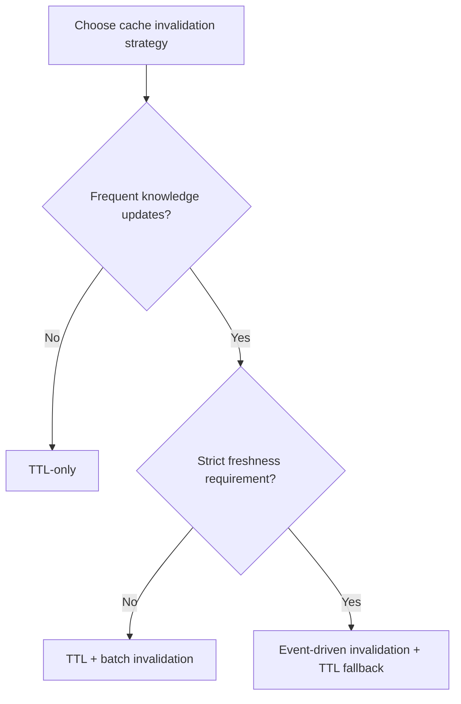
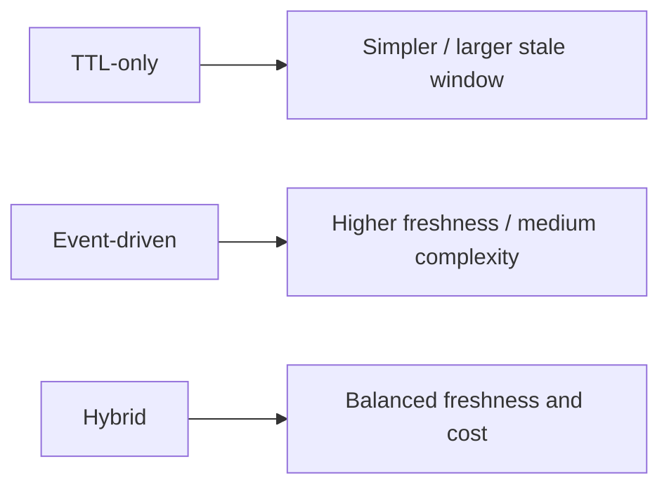
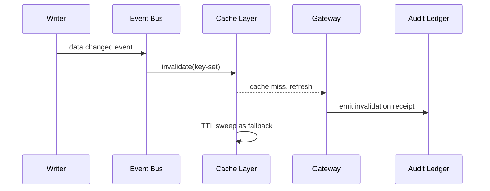

# Agent Retrieval Cache Invalidation FAQ (TTL Expiry vs Event-Driven Invalidation)

> Scope lock: this topic covers only retrieval-cache invalidation for agent/RAG tool paths, not model routing or identity injection.

## 1) 📌 Core conclusions at a glance (3 points)

1. **For high-update knowledge domains, event-driven invalidation should be the default** to reduce stale-read windows.  
2. **TTL-only is acceptable only for low-update, low-risk domains**; it is simple but weakest on freshness.  
3. **Production default should be hybrid**: TTL fallback + event-triggered invalidation + audit receipts.  

## 2) 🎯 Q1 / Q2 / Q3 (plain language + first principles)

### Q1: Why is TTL-only often insufficient?

- **Plain language**: right after data changes, users can still see old answers until TTL expires.  
- **First principle**: TTL is time-based, not change-aware; it guarantees eventual consistency, not immediate post-update consistency.  

### Q2: When is TTL-only still a valid choice?

- Low update frequency data;  
- Low business impact of stale reads;  
- Priority on minimal implementation and operations overhead.  

### Q3: How does hybrid invalidation governance work?

- **Plain language**: use TTL for baseline cleanup, and trigger instant invalidation on critical data updates.  
- **First principle**: combine periodic expiry with change-awareness to reduce stale reads while controlling overhead.  
- **Path**: write event → invalidation bus (Event Grid / Service Bus) → targeted key invalidation → TTL fallback sweep → audit ledger receipt.  

## 3) 🧭 Mermaid views (TD decision tree + LR path + sequence)

## 4) 📊 Architect decision matrix

| Dimension | TTL-only | Event-driven invalidation | Hybrid strategy (recommended) |
|---|---|---|---|
| Implementation complexity | Low | Medium | Medium |
| Data freshness | Low-Medium | High | High |
| Stale-window control | Weak | Strong | Strong |
| Ops overhead | Low | Medium | Medium |
| Default recommendation | ⚠ low-update domains | ✅ high-update domains | ✅ large-scale production |

## 5) 🧪 Quantitative example + 7-card insight

> Source of truth: `evidence/cycle-410-benchmark.json`.  
> Provenance labels: `measured` / `synthetic` / `anonymized_reported`; production paid-run metrics not executed are marked `not_measured`.

| Metric | TTL-only baseline | Hybrid invalidation baseline |
|---|---:|---:|
| Stale-read window P95 | 4.8 s | 1.3 s |
| End-to-end P95 latency | 237 ms | 191 ms |
| Invalidation-policy interception rate | 89.7% | 92.2% |
| Ops complexity score (1 low-10 high) | 3.9 | 6.0 |
| Production billing reconciliation | `not_measured` | `not_measured` |

7-card deck: `benchmark-cards.en.html` / `benchmark-cards.html` (4:5, CSP self-contained, coordinates from this cycle's sealed evidence only)

## 6) 🛠️ Production validation checklist

- [ ] Define TTL vs event invalidation boundaries by data domain/tenant
- [ ] Configure retry and dead-letter paths for invalidation events
- [ ] Configure bulk-key invalidation safety thresholds and backpressure
- [ ] Persist invalidation decisions into MCP/A2A audit ledger
- [ ] Run sampled replay checks for post-update visibility SLO
- [ ] Monitor stale-window, hit-rate, and cost metrics together
- [ ] Publish evidence bundle (latency/throughput/policy/cost) for each release

