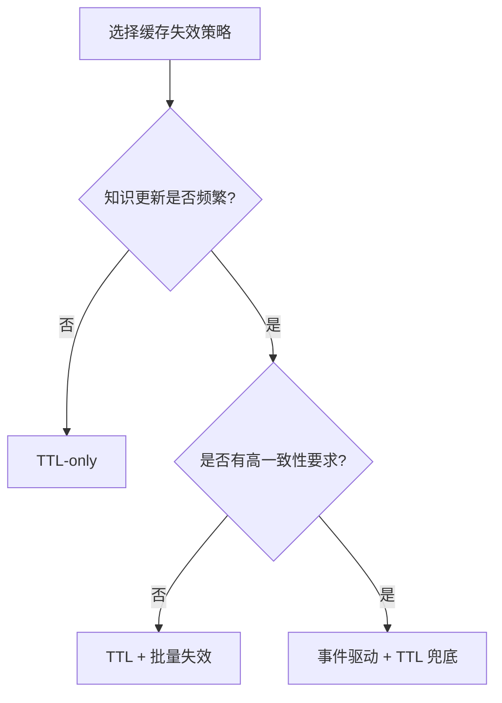
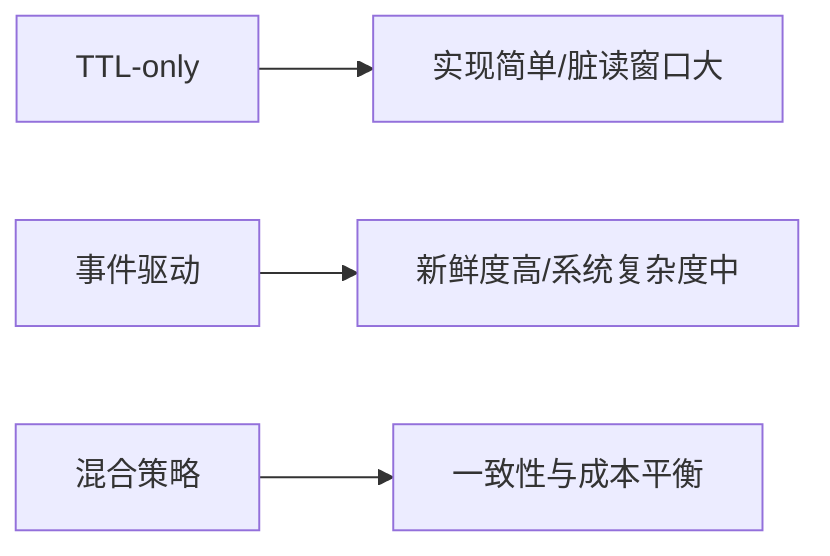
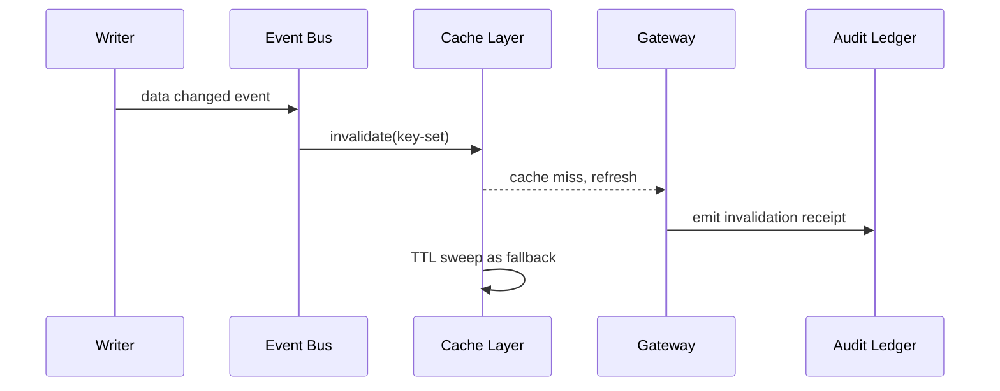

# Agent 检索缓存失效策略选型 FAQ（TTL 过期 vs 事件驱动失效）

> 专题边界：仅讨论 Agent 检索缓存（RAG/工具检索结果缓存）失效策略，不扩展到模型路由或身份注入。

## 1) 📌 核心结论速览（3 条）

1. **高更新频率知识库默认用事件驱动失效**，能明显缩短脏读窗口。  
2. **TTL-only 方案只适合更新慢、容错高场景**，实现最简单但一致性最弱。  
3. **生产推荐混合策略**：TTL 兜底 + 事件触发失效 + 审计回执，兼顾成本与正确性。  

## 2) 🎯 Q1 / Q2 / Q3（大白话 + 第一性原理）

### Q1：为什么不能只靠 TTL 定时过期？

- **大白话**：数据刚改完，缓存还没过期时，用户会看到“旧答案”。  
- **第一性原理**：TTL 是时间驱动，不感知数据变化；它只能“最终一致”，不能保证“变更后立刻一致”。  

### Q2：什么时候 TTL-only 仍然可接受？

- 知识更新频率低；  
- 错误读取旧数据的业务代价较低；  
- 主要目标是最小运维复杂度与最小实现成本。  

### Q3：核心机制 X（Hybrid Invalidation Governance）怎么工作？

- **大白话**：平时靠 TTL 回收，关键数据更新时立刻推送失效事件。  
- **第一性原理**：把“定时回收”和“变更感知”组合，减少脏读并控制系统开销。  
- **链路**：写入事件 → 失效总线（Event Grid/Service Bus）→ 缓存键精准失效 → TTL 兜底清扫 → 审计账本记录。  

## 3) 🧭 Mermaid（决策树 TD + 路径 LR + 时序）

## 4) 📊 架构师决策矩阵

| 维度 | TTL-only | 事件驱动失效 | 混合策略（推荐） |
|---|---|---|---|
| 实现复杂度 | 低 | 中 | 中 |
| 数据新鲜度 | 低-中 | 高 | 高 |
| 脏读窗口控制 | 弱 | 强 | 强 |
| 运维成本 | 低 | 中 | 中 |
| 默认建议 | ⚠ 低更新场景 | ✅ 高频更新场景 | ✅ 大规模生产场景 |

## 5) 🧪 定量算例 + 7-Card 洞察

> 数据来源：`evidence/cycle-410-benchmark.json`。  
> 标签口径：`measured` / `synthetic` / `anonymized_reported`；生产真实付费实验未执行标 `not_measured`。

| 指标 | TTL-only 基线 | 混合失效基线 |
|---|---:|---:|
| 脏读窗口 P95 | 4.8 s | 1.3 s |
| 端到端 P95 延迟 | 237 ms | 191 ms |
| 失效策略拦截率 | 89.7% | 92.2% |
| 运营复杂度评分（1低-10高） | 3.9 | 6.0 |
| 生产账单对账 | `not_measured` | `not_measured` |

7-card：`benchmark-cards.html` / `benchmark-cards.en.html`（4:5、自包含 CSP、坐标仅取本轮封存证据）

## 6) 🛠️ 生产核验 Checklist

- [ ] 定义 TTL 与事件失效边界（按数据域/租户）
- [ ] 配置事件丢失重试与死信队列
- [ ] 配置批量键失效保护阈值与回压
- [ ] 失效决策写入 MCP/A2A 审计账本
- [ ] 抽样回放验证“变更后可见”SLO
- [ ] 监控脏读窗口、命中率、成本三指标
- [ ] 发布时附证据包（latency/throughput/policy/cost）

